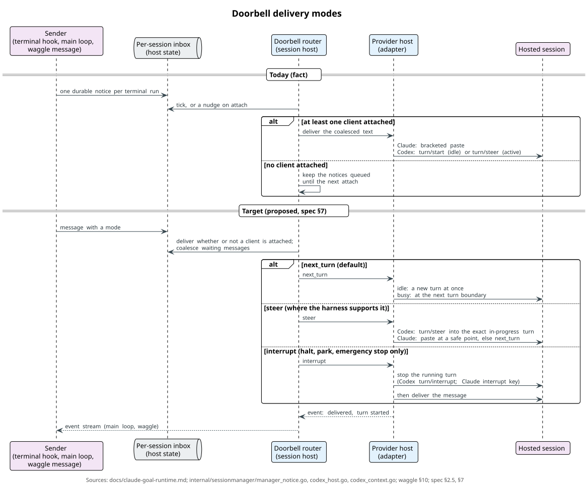
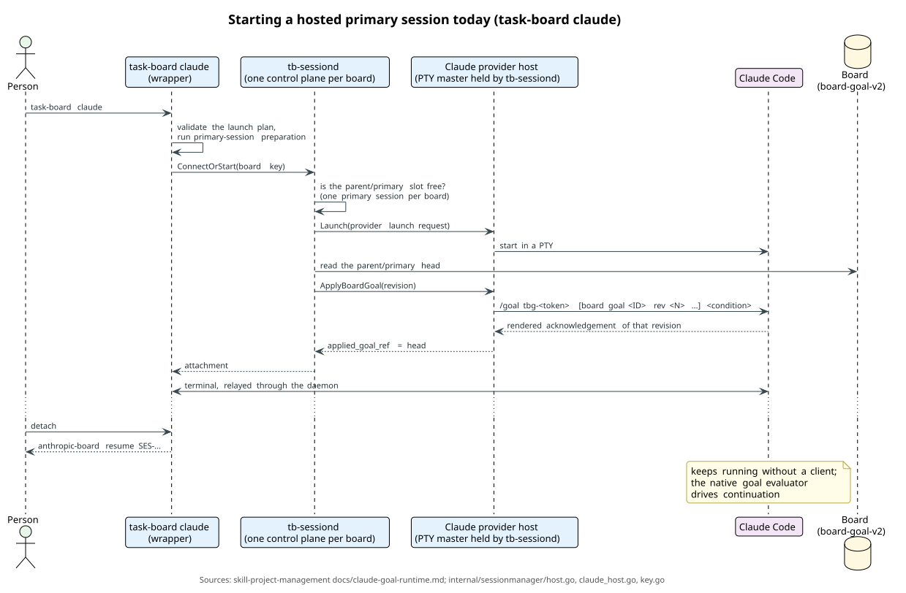
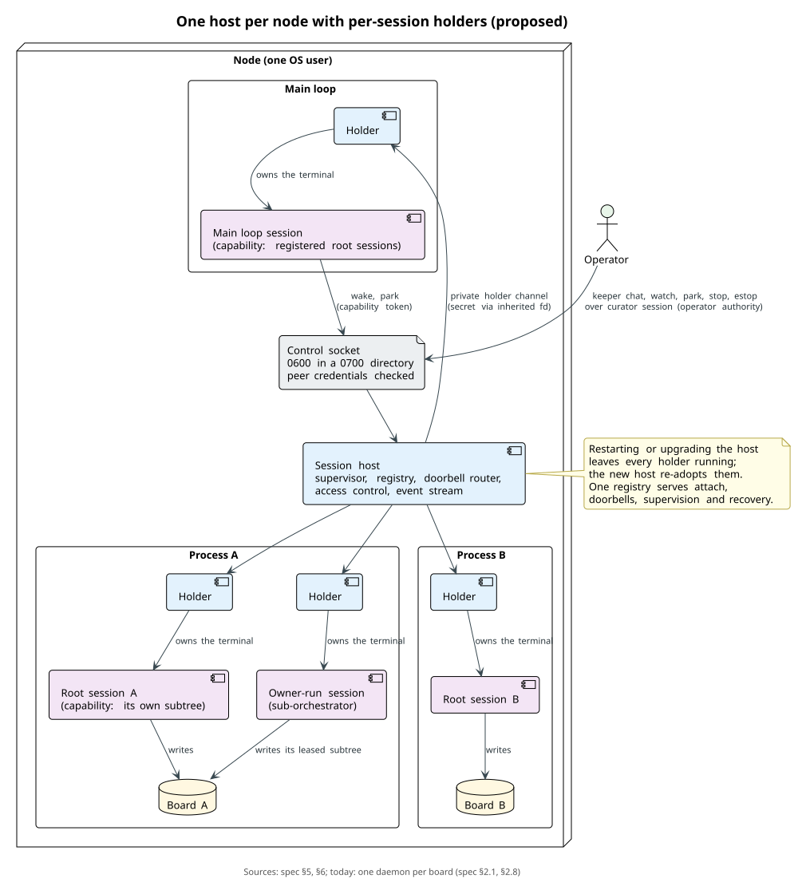
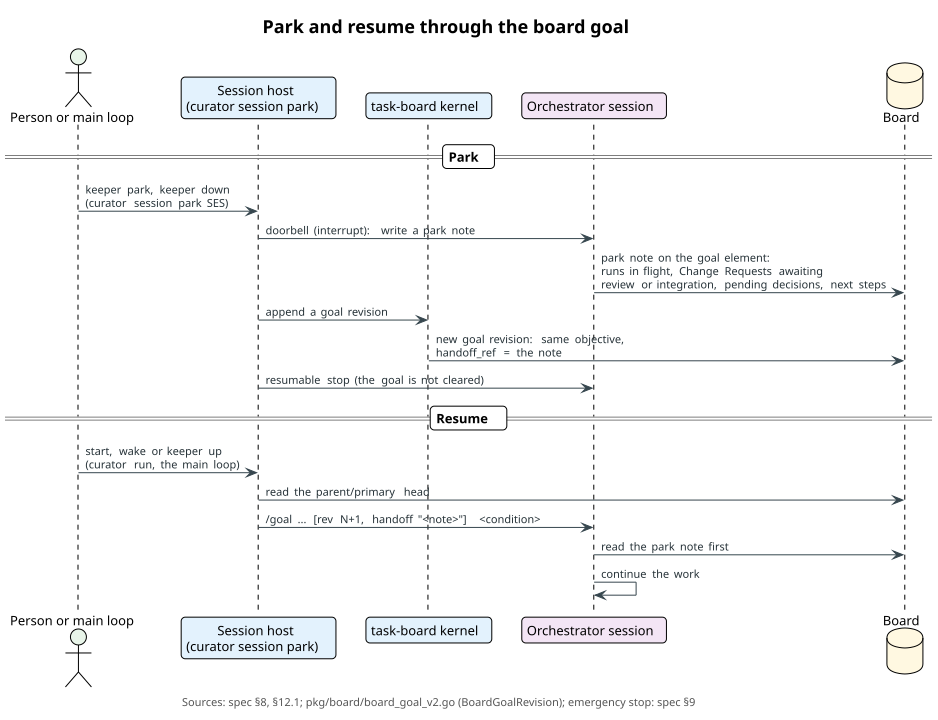
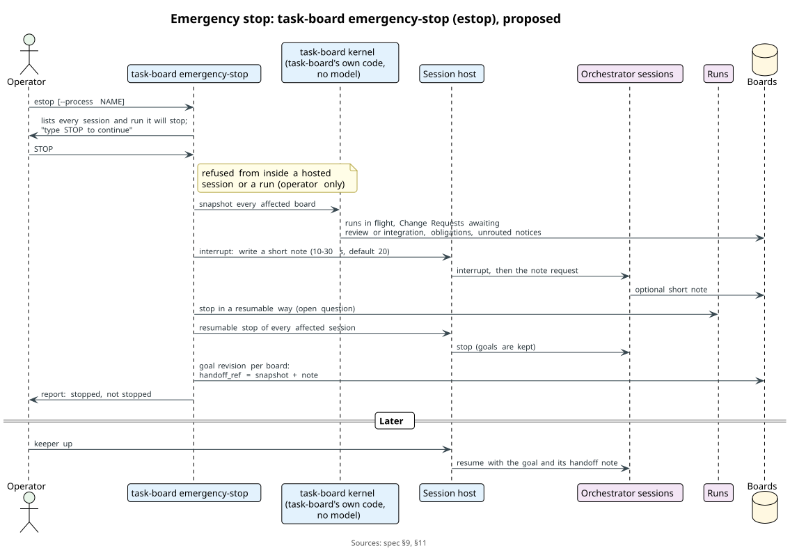
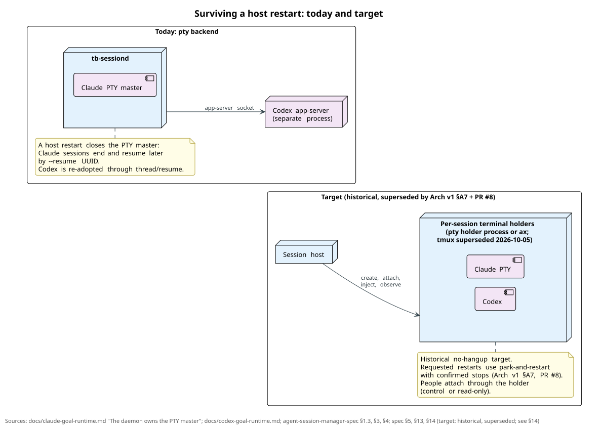

# Session host: specification

Status: **DRAFT v0.3**, 2026-09-27. Not normative. Track: [`track.md`](track.md). Diagrams: [`../diagrams/`](../diagrams/README.md). Command-line shape: relux-works/wiki `research/cli-shaping-review.md`, adopted 2026-09-27. Change logs: §17 (v0 → v0.1), §18 (v0.1 → v0.2) and §19 (v0.2 → v0.3).

A long-lived orchestrator needs something to keep it running when nobody is looking. That program:

- starts a harness in the right directory with the right goal;
- lets a person attach and watch;
- delivers messages into the session;
- reports what happened.

Today that program is `tb-sessiond`, the Session Manager inside task-board. It works, but three things limit it:

- it is fused into task-board;
- it holds Claude sessions in its own address space;
- it only serves one board's primary session and that board's tracked runs.

This specification describes the host as its own module. The module is first extracted as it is, then extended for the main loop that starts and supervises the root orchestrator of every process on a node.

Three markers say how settled a statement is:

- *decided (date)*: the operator confirmed it;
- *proposed*: the author's resolution, open to review;
- *fact*: a description of the current code, with its source.

Sources of facts:

- relux-works/skill-project-management at `origin/main` `9f594dba`. Paths below are relative to that repository unless stated.
- relux-works/agent-session-manager-spec at `32b3f2b` (`ax` v0.7.0).
- relux-works/curator-spec Decisions 0013, 0019 and 0021 at `origin/main` `3d2c611`.
- relux-works/waggle `spec/waggle.md` §10 at `origin/main`.

Related specifications:

- the process-configuration specification (relux-works/curator-playbook): one root orchestrator per process and the board goal;
- the trust specification (relux-works/curator-trust `spec/trust.md`): who counts as a person, presence-bound confirmations, and running agents under an operating-system account of their own;
- the main-loop specification (relux-works/curator-keeper);
- waggle (relux-works/waggle): the doorbell's delivery modes and the carrier of messages between orchestrators;
- Agent Session Manager (`ax`, relux-works/agent-session-manager).

## Names used in this specification *(decided 2026-09-25)*

People read about the system in the Apiary names. Beekeeping words appear only where people type them in the apiary: the `keeper` command and its nouns (`keeper hive …`), the apiary's directories and the profile name `apiary`. Specifications, code, the host's and the kernel's command lines, flags, configuration keys and board items use technical terms; the same rule stands in the main-loop specification (Names) and in the process-configuration specification §16 *(decided 2026-09-27)*. This is the map; the rest of this document uses the technical terms.

| Apiary name | Technical term | What it is |
| --- | --- | --- |
| apiary | the system | everything one owner runs: all nodes, processes and operators; the smallest apiary is one node |
| yard | node | one machine |
| keeper | main loop | the node's master orchestrator: routes a person's requests, starts and supervises the root orchestrators |
| hive | process | one domain with its own directory, board and exactly one root orchestrator: a family calendar, a café, a hobby project |
| queen | root orchestrator | the one orchestrator started from outside a process; its hosted session is the root session |
| comb | board | the process's board; its cells are the tasks |
| bee | run | one agent run of a role; a goal-bound run is hosted as an owner-run session |

---

## 0. The design on one screen

- **What it is.** The session host keeps agent sessions alive in the background. It starts a harness in a given directory with a given goal, lets a person attach and detach, delivers messages into a session (the doorbell) and reports events. *fact for today; the module is decided*
- **Phase 1: extract it as it is.** The provider-host plane of `tb-sessiond` moves into this repository behind a contract, with no change in behaviour. *decided (2026-09-24), priority* Everything after §3 is architecture for later phases.
- **One host per node.** One daemon per OS user supervises every session: the main loop's and every root orchestrator's. Each session gets its own terminal holder, so the daemon can restart and upgrade without killing sessions. *proposed, pending the operator*
- **Access control.** Today one bearer token, which any process of the operator's user can read, controls every session. The target:
  - peer-credential checks;
  - a capability token per session: a session acts only on itself and its own children;
  - a supervision matrix;
  - operator commands backed by the operator's own authority.

  *proposed; closing access is the first refactor after the as-is extraction, decided (2026-09-25)*
- **Doorbell modes.** `next_turn` is the default. `steer` puts the message into the running turn where the harness can take it. `interrupt` is only for halt, park and emergency stop. Delivery no longer waits for an attached client. *proposed*
- **Park and emergency stop.** Park is the orderly stop: the orchestrator writes a note, the note is bound into the board goal, and the next start resumes from it. The host's `curator session park` does it, and `keeper park` fronts it. The emergency stop is a separate, unmistakable command for when there is no time: `keeper estop [<hive>]`, over the host's `curator session estop`. The kernel adds only a snapshot, `task-board board snapshot`, and no kernel command parks or stops a session or the node. *park decided (2026-09-24); the commands decided (2026-09-27); the emergency stop's mechanics proposed*
- **Its command line.** The host is a Curator provider, `curator-session`, so people and tools reach it as `curator session list|show|status|attach|watch|park|stop|estop|logs|doctor|restart`, and keeper fronts it (§12.1). `task-board session` stays an alias for one release after the node host lands, and its context-registry commands move to `task-board context`. Phase 1 changes no command. *decided (2026-09-27)*
- **A session is a cache.** The goal, the handoff note and the board carry the work across compaction and restarts. Adapters report context and limits so that a handoff is written before compaction. *proposed, not the first priority*
- **One entry point after a reboot.** `keeper up`, started at login, brings the host, the main loop and every root orchestrator back. *proposed*
- **Conversation and watch.** `keeper` alone opens the main loop's session. `keeper chat` with no target lists every session and opens a conversation with the chosen one; `keeper watch` only looks. Underneath all three are the host's `curator session attach`, in control mode, and `curator session watch`, read-only. *proposed; the command names are the operator's (2026-09-25)*
- **Later: pluggable terminal backends.** `pty`, `tmux` and `ax`, behind a transport abstraction. *decided to record (2026-09-24); the design is proposed*

## 1. Terms

| Term | Meaning |
| --- | --- |
| host | the process that owns hosted sessions on a node; today `tb-sessiond` |
| hosted session | a harness process (Claude Code, Codex, later others) whose lifetime, terminal and goal the host owns |
| root session | the one hosted session that holds a board's `parent/primary` goal slot: the process's root orchestrator. task-board calls it the primary session |
| owner-run session | a hosted session that holds a `run/RUN-*` goal slot: a sub-orchestrator or another goal-bound run spawned by a root session |
| client, attachment | a terminal connected to a hosted session; a session may have none |
| doorbell | a message the host types or submits into a running session so that it takes a turn; task-board calls these in-session notices |
| provider host | the per-harness adapter that launches, restores, drives and stops one harness (`ProviderHost`) |
| terminal holder | the process that owns one session's terminal: the host itself today, a per-session holder process later (§5, §13) |
| terminal backend | the kind of holder: `pty`, `tmux` or `ax` (§13) |
| capability token | a secret the host issues to one session, naming what that session may do (§6) |
| kernel | task-board's own code, the deterministic part of the board with no model involved. "The kernel writes a snapshot" means task-board writes it |
| main loop | the node's master orchestrator (main-loop specification) |
| `curator session` | the host's command line: the Curator provider `curator-session`, which `curator session …` dispatches to and `keeper` fronts (§12.1) |

## 2. Today's implementation *(fact)*

### 2.1 One control plane per board

- `tb-sessiond` is keyed by board: a `BoardKey` "identifies one Session Manager control plane" (`tools/board-cli/internal/sessionmanager/key.go`).
- Its state lives in the user state directory, never under the board tree (`layout.go`, `DefaultLayout`). The per-session notice queues are in its `NoticesDir` (`layout.go:44-48`).
- Startup reconciles durable records, restores running sessions, sweeps stale sockets and reports `startup_healthy` (`docs/codex-goal-runtime.md`, "Self-restoring startup").

### 2.2 Root (primary) sessions

- `task-board claude` and `task-board codex` start or attach the board's primary session. The wrapper validates the launch plan and runs primary-session preparation, then calls `ConnectOrStart` (`docs/claude-goal-runtime.md:32-39`).
- The `parent/primary` slot is singular and provider-independent: "one board has one authoritative primary goal owner". A second provider is refused with `session_provider_conflict`, or, on a TTY, offered a takeover (`docs/claude-goal-runtime.md:9-29`; `docs/codex-goal-runtime.md:10-31`).
- A graceful detach prints `anthropic-board resume SES-...` or `openai-board resume SES-...`. The manager then either reattaches a healthy host, or relaunches a dead one with its durable native identity: `--resume` with the UUID for Claude, `thread/resume` for Codex. Before exposing the terminal it reconciles the current primary goal (`docs/claude-goal-runtime.md:290-303`; `docs/codex-goal-runtime.md:233-247`).
- `task-board session stop SESSION-ID` stops one session "without clearing its board goal" (`tools/board-cli/cmd/session.go:94-95`). The other operator commands are `status`, `list`, `logs [-f]`, `doctor` and `restart` (`cmd/session.go:35-274`).

### 2.3 Owner-run sessions

A goal-bound spawn runs in its own hosted session. The manager:

- "starts or resumes one PTY for that run owner";
- strips the parent's Session Manager and app-server credentials and provider session markers;
- injects the native goal and waits for acknowledgement of the exact revision (`docs/claude-goal-runtime.md:41-56`).

Sub-orchestrators spawned with `--role orchestrator` live here. A person cannot attach to them. They are observable only through `task-board spawn transcript`, `observe` and `events`.

### 2.4 Goals and continuation

- The host delivers the board goal as the harness's native goal. For Claude that is `/goal tbg-<token> [board goal <ID> rev <N> - reference only, not the condition - objective "<excerpt>"] <provider-condition>`, submitted through bracketed paste (`docs/claude-goal-runtime.md:57-66, 180-183`). Codex receives the same condition through its app-server.
- "The provider-native evaluator owns continuation". So a restarted or resumed session goes on working without being told to: the host re-applies the current goal on resume, and the harness's own evaluator keeps it going until the condition holds (`docs/claude-goal-runtime.md:180-183, 298-303`).
- The goal itself is task-board data. `BoardGoalRevision` in `pkg/board/board_goal_v2.go:173` carries the objective, the provider condition, the reason and the lineage. It has no field for a handoff note today (§8).

### 2.5 The doorbell today: in-session notices

- **Who can be rung.** Only a hosted primary session is addressable (`TASK_BOARD_MANAGED_SESSION_ID`). Owner-run sessions are not, and the marker is stripped from their children (`docs/claude-goal-runtime.md:392-403`).
- **Producer.** The tracked-spawn terminal hook (`DeliverTerminal`) writes one durable notice per terminal run into the session's inbox.
- **Consumer.** A pump in the daemon delivers only to a session that is running, whose host implements `ProviderSessionNotifier`, and that "has at least one attached client" (`internal/sessionmanager/manager_notice.go:76-77, 90-96`). A detached session keeps its notices queued. On the next attach they are replayed, coalesced into one message.
- **Delivery into Claude.** The text goes in by bracketed paste into the PTY, serialized with goal injection (`docs/claude-goal-runtime.md:424-447`; `internal/sessionmanager/claude_host.go:1090-1111`). "Claude Code does not process typed input … while a tool call is executing": injected text sits in the PTY input queue until the running call returns (`docs/claude-goal-runtime.md:213-219`).
- **Delivery into Codex.** An idle thread gets a new turn through `turn/start`. An active thread gets the text steered into its exact in-progress turn through `turn/steer` with the expected turn ID, and is refused when that turn is ambiguous (`internal/sessionmanager/codex_host.go:700-780`). The app-server also offers `turn/interrupt` (`internal/sessionmanager/codex_context.go:663`).
- **waggle today.** waggle §10 maps its delivery modes onto these mechanics:
  - `interrupt` becomes a Codex `turn/steer` or a Claude paste at a safe point;
  - `next_turn` becomes a Codex `thread/queue/add`, or a Claude paste after the turn;
  - `on_request` rings no doorbell.

  It also says that "with no client attached messages wait durably".

### 2.6 Provider hosts

The seam the module is extracted along already exists as Go interfaces in `internal/sessionmanager/host.go:32-165`:

- `ProviderHost`: `State`, `Snapshot`, `ApplyBoardGoal`, `RollbackBoardGoal`, `Stop`;
- `ProviderHostFactory`: `Provider`, `Launch`, `Restore`;
- the optional capabilities: `ProviderAttachmentTarget`, `ProviderSessionNotifier`, `ProviderNativeIdentity`, `ProviderOwnerRunner`, `ProviderClientHome`, `ProviderClientToolPolicy` and `ProviderLaunchReporter`.

There are two implementations:

- **Claude.** The host starts the harness in a PTY it creates itself (`claude_host.go:727`, `pty.StartWithSize`).
- **Codex.** The host starts one private app-server per session and one thread per logical session (`codex_host.go:136-227`; `docs/codex-goal-runtime.md:1-8`).

### 2.7 Restart

"A Claude host's PTY master file descriptor is held in the `tb-sessiond` process itself". The daemon exiting closes that master, so "a Claude host does not survive a manager restart". A Codex host does, because its app-server is a separate process the replacement daemon reconnects to (`docs/claude-goal-runtime.md:305-314`).

Two guards follow from this (`internal/sessionmanager/hosted_takeover_guard.go`):

- A call from inside a hosted session that would replace the daemon is refused.
- From an outside shell, replacement is refused while live PTY-held sessions exist, unless the operator runs `task-board session restart --stop-hosted` (`docs/claude-goal-runtime.md:316-341`).

### 2.8 Access control today

- **The socket.** The control socket lives in the per-board state directory, or under a per-user `/tmp/tbsm-<hash>/` when the path is too long for Darwin (`layout.go:74-86`). It is created with `net.Listen` and then set to mode 0600 (`daemon.go:154-168`).
- **The token.** The daemon writes one random bearer token to a private file in its state directory. Every control request must carry it (`daemon.go:170-190`; `control.go:431-442`).
- **The consequence.** One token grants every operation on every session of that board: stop, attach, deliver, take over. Every agent session and every run runs as the operator's own OS user, and any of them can read the token file. So any agent can operate on any session. The protection keeps out other OS users, not the operator's own agents.

## 3. Phase 1: extract the module as it is *(decided 2026-09-24, priority)*

The first step moves code, not behaviour. Improvements come after the module stands on its own. Sections 4 to 14 describe later phases; none of them is part of phase 1.

### 3.1 What moves here

- **The provider-host plane:**
  - the `ProviderHost` and `ProviderHostFactory` contract and its optional capabilities;
  - the Claude PTY host and the Codex app-server host;
  - attachments and the terminal relay;
  - the notice inbox and pump;
  - session records and their store;
  - liveness, restore and repair;
  - the operator log.
- **The daemon skeleton:** instance lock, control socket, self-restoring startup and health reporting. It is parameterized by a key, today task-board's `BoardKey`.

### 3.2 What stays in task-board

- The board and its goal ledger (`board-goal-v2`): what the goal is, who may write it, and when it counts as achieved.
- Routing, the spawn runtime, run manifests, acceptance and handoff evidence.
- The `task-board claude|codex`, `session` and `spawn` commands. They keep their names and behaviour and reach the module through a thin seam: task-board supplies the goal revision to apply, and consumes the host's acknowledgements, events and notices. Their later names are in §12.1.

### 3.3 The contract

- **In process first.** Phase 1 keeps the adapters as in-process Go implementations behind the existing interfaces, exported from this module. *proposed*
- **The out-of-process form follows the ax provider plugin protocol** (`ax` SPEC §7.1-§7.3): *proposed*
  - line-delimited JSON over stdin/stdout, one plugin process per operation;
  - a manifest and a probe;
  - structured errors that fail closed.

  A plugin exits after each operation, so only stateless operations cross that boundary: probe, launch spelling, goal-command rendering and acknowledgement parsing. The long-lived terminal stays with the host or its terminal holder (§5, §13).
- **Operations:** start, resume, stop, status, attach target, apply a goal revision, clear it, acknowledge the exact revision, deliver a notice, and an event stream.
- **Adapters:** Claude (PTY) and Codex (app-server) first. Muse, agy, Pi and Qwen follow, each under its own story.

### 3.4 Where it sits in the launch plane

- A person's sessions enter through `curator run`. With the `ax` integration configured, they are hosted "from birth by whatever implements the `ax start --launch-plan` contract", and "until an `ax` implementation ships, task-board's session daemon implements the contract through a bridge" (curator-spec Decision 0021 §2).
- A host "receives a composed plan and never composes" (0021 §2; Decision 0019). This module is where that bridge's hosting half lives.
- The bridge's shape, an `ax` shim or the daemon answering `ax start`, is Decision 0021 open question 1.
- Tracked non-interactive children stay with `task-board spawn` (0021 §6).
- **Until the bridge exists**, primary and goal-bound sessions are built with the same construction as children: a per-role Curator profile through agents-management. Gate A does not wait for the `curator run` → host bridge, so the bridge is a later dependency (track SH6), not a prerequisite of SH1 or SH2. *decided 2026-09-28*

### 3.5 Done when

- task-board's session, goal and notice test suites pass unchanged against the extracted module.
- The goldens for both harnesses are byte-identical.
- The operator commands behave as before.
- No behaviour difference is reported in the change log. Any difference found is either removed or listed and accepted by the operator.

## 4. Requirements from the main loop *(proposed; later phases)*

The main loop starts and supervises the root orchestrator of every process on its node. The host must support it:

1. **R1. Start in a process directory.** Start a hosted root session in any process directory the main loop has registered:
   - the session gets that directory as its working directory, the process's Curator profile and managed home, and the board's `parent/primary` goal;
   - it runs in the background with no client attached;
   - the launch is composed by `curator run` (Decision 0021) and handed to the host once the bridge exists; until then it uses the children's construction (§3.4).
2. **R2. One root session per process.** Exactly one root session is started from outside for each process. Today's singular `parent/primary` slot already enforces this per board (§2.2). Sub-orchestrators and runs are spawned by the root session inside its own board; the main loop never starts them.
3. **R3. Attach.** A person can attach to root sessions and to owner-run sub-orchestrators, in control mode (`keeper chat`) or read-only mode (`keeper watch`) (§12). Attaching to short-lived worker runs is optional; their transcripts suffice.
4. **R4. Doorbell for detached sessions.** Notices and main-loop messages reach a running session that has no client attached, through the delivery modes of §7.
5. **R5. Supervision.** The main loop can wake, park and stop root sessions within the matrix of §6.3. The operator can always stop a session.
6. **R6. Events.** The host emits a stream that the main loop and waggle consume:
   - session state changes;
   - goal acknowledgements;
   - turn starts and ends;
   - context and limit readings (§10);
   - failure markers;
   - park and emergency-stop completion.
7. **R7. Many processes on one node.** One host serves all of them (§5).
8. **R8. Recovery.** After a reboot every session that was running comes back through one entry point (§11).

## 5. One host per node *(proposed; pending the operator)*

Today each board has its own daemon (§2.1). On a node with a main loop and several processes, that means several daemons, several tokens, several upgrade paths, and several places holding terminals. The proposal replaces this with one host per OS user and one terminal holder per session.

- **One supervisor.** One host process per OS user on the node supervises every hosted session: the main loop's session, each process's root session, and their owner-run sessions.
- **Per-board state inside.** Each board keeps its own namespace inside that host. The singular `parent/primary` slot stays per board, so R2 holds as today.
- **One holder per session.** Each session gets its own terminal holder: a small `pty` holder process, a tmux pane, or later `ax` (§13). The holder owns the terminal and the harness process. The host owns the registry, the goals' delivery, the doorbell router, access control and the event stream.
- **Restart without hang-up.** When the host restarts or upgrades, the holders keep running. The new host re-adopts them from its durable records and the holders' sockets, as today's startup already does for Codex (§2.7).
- **One registry.** One list of sessions serves attach (§12), the doorbell (§7), supervision (§6) and recovery (§11).

Why this is more stable than a daemon per board:

- A harness that crashes takes down its holder, not the host.
- A host that crashes or upgrades takes down no harness.
- There is one upgrade path, one startup reconciliation and one event stream, instead of one per board.
- The main loop talks to one endpoint, not to a daemon it must find for each process.

Why it is safer:

- Access control, the supervision matrix and the audit log live in one place, instead of one bearer token file per board (§2.8).
- A holder's socket accepts only the host. The host authenticates to it with a secret passed through an inherited file descriptor when it spawns the holder, and that secret is never written to disk.
- The limits stay the same as in §6.4: processes of the same OS user can still signal each other, and can trace each other where the operating system allows it.

Phase 1 keeps one daemon per board. The node host is a later milestone (track SH3).

## 6. Access security *(proposed)*

Today one token controls everything, and every agent can read it (§2.8). The target closes the socket, identifies callers and gives each session only the powers it needs.

*Order (decided 2026-09-25).* Phase 1 extracts the host as it is, token and all. Closing access, as described in this section, is the first refactor after that extraction.

### 6.1 The socket

- The control socket is created inside a directory of mode 0700 that the host creates before it listens. The socket itself is mode 0600. This closes the window between `listen` and `chmod` of §2.8.
- Every connection's peer credentials are checked: `getpeereid` or `LOCAL_PEERCRED` on macOS, `SO_PEERCRED` on Linux. A peer of another UID is refused.
- The Darwin fallback path under `/tmp` gets the same private directory.

### 6.2 Capability tokens

Every agent runs as the operator's UID, so a UID check cannot tell sessions apart. Authorization therefore uses capability tokens.

- **Per session.** The host issues each hosted session its own token when it starts it. The token says what that session may act on: itself and the sessions it spawned. It is passed into the session's environment and is valid only while the session lives.
- **The main loop's token** covers the root sessions of the processes registered with it. It covers nothing inside them.
- **Operator commands** need the operator's authority: attaching with control, stopping any session, parking any session, and emergency stop.
  - Until the trust component exists, the operator's authority is a CLI act outside any hosted session or run. The host checks that the caller carries no session token and that its process is not a descendant of a hosted session. This is a guardrail, as the process-configuration specification calls unsigned human acts.
  - From the trust component on, it is a presence-bound confirmation: the companion app, or the operating system's user authentication (relux-works/curator-trust `spec/trust.md`).
- **Every accepted request is logged** with the token's session, the act and its target.

### 6.3 The supervision matrix

| Actor | Wake | Park | Stop | Read events and transcripts | Attach | Emergency stop |
| --- | --- | --- | --- | --- | --- | --- |
| the operator (a person) | every session | every session | every session | every session | every session, control or read-only | yes |
| the main loop's session | root sessions of registered processes | root sessions of registered processes | only with the operator's confirmation or a delegation that covers it | registered processes' root sessions | never | only under a delegation that names the trigger |
| a root session | its own subtree | its own subtree | its own subtree | its own subtree | never | no |
| an owner-run session | its own spawned runs | its own spawned runs | its own spawned runs | its own spawned runs | never | no |
| a worker run | nothing | nothing | nothing | itself | never | no |

- Attach is for people. Agents read events and transcripts instead.
- From waggle milestone CM2, wake, park and stop between sessions travel as signed waggle `cmd` messages in the `halts` category, and the host verifies them against the roster before acting. Until then, the capability token is the check.
- The main-loop specification states the same matrix for the main loop's side.

### 6.4 What this does not stop

Tokens in a session's environment can be read by other processes of the same user on systems that expose process environments. On Linux, `/proc/<pid>/environ` is readable by the same UID. So capability tokens give least privilege and attribution among well-behaved agents; they are not a boundary against a hostile one. The boundary is either of these:

- running agents under an operating-system account separate from the operator's;
- the presence-bound confirmations of the trust component, for the acts that need a person.

Both belong to the trust specification (open question 11).

## 7. Doorbell delivery modes *(proposed)*

A message into a session must be both autonomous and stable. The session must act on it without anyone attached, and it must not break the work in progress. The host delivers every message in one of three modes.

| Mode | When | Meaning |
| --- | --- | --- |
| `next_turn` | the default for every message | delivered at the next turn boundary. A session that is idle gets a new turn at once |
| `steer` | a message that should influence the running turn, where the harness supports it | put into the running turn without stopping it |
| `interrupt` | only halt, park and emergency stop | the running turn is stopped first, then the message is delivered |

Per adapter:

| Adapter | `next_turn` | `steer` | `interrupt` |
| --- | --- | --- | --- |
| Codex (app-server) | `turn/start` when idle (fact, `codex_host.go`); queued for after the turn otherwise (`thread/queue/add`, per waggle §10) | `turn/steer` with the expected turn ID into the exact in-progress turn; refused when that turn is ambiguous (fact, `codex_host.go:736-772`) | `turn/interrupt` (fact, `codex_context.go:663`), then `turn/start` |
| Claude Code (PTY) | submitted by bracketed paste when the prompt is free; typed input waits in the input queue while a tool call runs (fact, `docs/claude-goal-runtime.md:213-219`) | a paste at a safe point between tool calls. When no safe point can be observed, it degrades to `next_turn` *proposed; to verify per harness version* | the harness's interrupt key (Escape), then the paste *proposed; to verify* |

- **Delivery does not depend on an attached client.** This removes the condition in `manager_notice.go:94`. Coalescing stays: several waiting messages arrive as one.
- **Every delivered turn emits an event** (R6), so turns that nobody watches are visible to the main loop and to people.
- **Mapping to waggle:**
  - waggle's `next_turn` is the host's `next_turn`.
  - waggle's `interrupt`, which waggle §10 implements as a Codex `turn/steer` or a Claude safe-point paste, is the host's `steer`.
  - The host's own `interrupt`, which stops the turn, is reserved for `cmd.halt`, park and emergency stop.
  - waggle's `on_request` rings no doorbell; the message waits to be pulled.
- **waggle needs an amendment.** Its §10 still lets messages wait while no client is attached. The detached delivery of this section needs that sentence to change (track dependency).

### 7.1 Harness-specific mechanisms inside adapters *(proposed)*

An adapter may use a harness's own extension mechanism where it makes the contract more reliable. That stays an implementation detail of the adapter; the contract of §3.3 and the modes above do not change.

- **Example: Claude Mods.** Claude Code plugins with function hooks: a TypeScript module (`hooks/register.ts` in an ordinary plugin directory) registers handlers that wrap engine events and interface rendering, like middleware. In the local CLI they are enabled by `CLAUDE_CODE_ENABLE_FUNCTION_HOOKS=1`. They are in early access, and their API may change between releases without notice.
- **What the Claude adapter could use them for:**
  - reliable message delivery, instead of typing into the terminal;
  - context telemetry for §10;
  - panels that show the board and the goal inside the harness.
- **Never for authority.** Authorization must not depend on a mod that can be removed or disabled, and their own guidance says so. Supervision, capability tokens and confirmations stay in the host and the trust component (§6).
- **Not a dependency now.** It is early access and Claude-only. The PTY paths of the table above remain the implementation.

## 8. Park *(decided 2026-09-24; the mechanics proposed)*

Park is the orderly stop. It leaves a clear entry point for the next start.

`curator session park <session>` starts it; `keeper park` and `keeper down` front it for the person and the main loop (§12.1). *decided 2026-09-27; `task-board session park` is withdrawn*

1. The host rings the session's doorbell with a park directive, in `interrupt` mode.
2. The orchestrator writes a park note as a resource of the goal's element. The note lists:
   - runs in flight;
   - Change Requests awaiting review or integration;
   - decisions waiting for a person;
   - the next steps;
   - pointers to anything else needed.
3. The host asks the kernel, and task-board appends a goal revision with the same objective and condition and a new `handoff_ref` field naming the note. The field is an addition to `BoardGoalRevision` (§2.4). Nothing else about the goal changes.
4. The host stops the session through the resumable stop. The goal is not cleared (§2.2).
5. On the next start the native goal payload carries the reference, for example `[board goal <ID> rev <N+1> ... handoff "<note>"]`. The start may be `curator run`, or its alias `task-board claude|codex`, the main loop's wake, or `keeper up` (§11). The session reads the note first, and the native evaluator continues from there (§2.4).

If the orchestrator does not write the note within a bound, the kernel snapshot of §9 becomes the note.

The same mechanism writes a handoff without stopping, before compaction (§10).

**Runs park by directive.** A run, whether a sub-orchestrator in its owner-run session or a worker, is a board record the kernel tracks, so it parks through the kernel: `task-board spawn directive <RUN> park`, a new directive kind beside `cancel` and `pause_after_checkpoint`. For an owner-run session the host carries it out as in steps 1–4. A root session parks its sub-orchestrators this way, and the person does through `keeper park <hive>/<RUN-ID>`. *decided 2026-09-27; the directive's semantics proposed*

## 9. Emergency stop *(proposed)*

For a stop that cannot wait, for example power about to fail, there is a separate command. It is not a flag on park, so that nobody runs it by accident and everybody who reads it knows what it is.

- **One command for people:** `keeper estop [<hive>]`, for the whole node or for one process. Underneath is the host's `curator session estop [<process>]`. No kernel command spells an emergency stop, because it acts on sessions and on the node, which the kernel does not own; the kernel contributes the snapshot, `task-board board snapshot`. *decided 2026-09-27; `task-board emergency-stop` and its alias `estop` are withdrawn*
- **A loud confirmation.** The command prints what it is about to stop: every hosted session and every run on the node, or of one process. It then asks for the phrase `EMERGENCY STOP` and the operator's presence: the operating system's user authentication on the node, or the companion app's presence-bound signature (main-loop specification §10.3; relux-works/curator-trust). No flag replaces the phrase, and the kernel's `--confirm` stays a plain acknowledgement of a destructive act.
- **Operator, or the main loop under a delegation.** The operator may always run it. The main loop may trigger it only under a delegation that names the trigger (for example exhausted limits or a detected runaway); root orchestrators, sub-orchestrators and runs are refused (§6.3). *decided 2026-09-25*

What it does, in order:

1. **The kernel writes a snapshot for every affected board:** the host runs `task-board board snapshot` on each. The kernel is task-board's own code, not a model. It records:
   - the runs in flight and their states;
   - Change Requests awaiting review or integration;
   - the output of `task-board worktree obligations`;
   - unrouted notices.
2. **Each orchestrator may add a short note** within a bound of 10 to 30 seconds (default 20). A missing note does not delay anything.
3. **Runs are stopped** so that they can resume. Today a run is cancelled, not suspended, so a resumable suspension is open question 5.
4. **Sessions are stopped** through the resumable stop. Each goal gets a revision whose `handoff_ref` names the snapshot and the note, appended by the kernel as in §8.
5. **The command reports** what it stopped and what it could not stop.

`keeper up` (§11) brings everything back from those notes.

## 10. Compaction and context *(proposed; designed now, not the first priority)*

- **A session is a cache.** The authoritative state is the board, its goal and the handoff note, never the harness's context. A session must survive compaction or replacement by rereading them.
- **Adapters report context telemetry** as events (R6):
  - Claude Code's `PreCompact` hook and the context usage its status line receives;
  - Codex's token-usage events from the app-server.

  The exact fields are verified per harness version.
- **Before compaction** the host rings the orchestrator in `next_turn` mode, or `steer` when compaction is imminent, to write a handoff. task-board appends a goal revision with `handoff_ref`, as in §8, and the session keeps running. After compaction the native goal payload carries the reference.
- **Limits.** The same events carry provider limit readings that the launch plane already tracks.
- **The watchdog** of the main-loop specification consumes both kinds of events. It asks for a handoff early, parks a session that cannot continue, and tells the person.

## 11. Reboot restore *(proposed)*

- **One entry point:** `keeper up`. A user login agent starts it at login: a launchd user agent on macOS, a systemd user unit on Linux.
- **The order:**
  1. The host comes up and re-adopts any holders that survived (§5).
  2. The main loop's session starts or resumes.
  3. Each registered process's root session comes back. It resumes its native session when it can (Claude `--resume` with the UUID, Codex `thread/resume`). Otherwise it starts fresh with its goal and its latest handoff or park note (§8, §9).
- **A report** tells the person what came back, what started fresh and what failed.
- **`keeper down`** parks every session in order before a planned shutdown.

## 12. Conversation, watch and the picker *(proposed)*

The person uses three commands of the main loop; underneath each is the host's attach operation, `curator session attach` in control mode or `curator session watch` read-only.

- **`keeper`** with no arguments opens the main loop's session, starting the node first when it is down.
- **`keeper chat` with no target** opens a small terminal UI over the host's registry. It lists every hosted session with:
  - its process and role: main loop, root orchestrator or sub-orchestrator;
  - its harness;
  - its state and attached clients;
  - its last activity.

  The person picks one and opens a conversation with it (control mode) or a read-only view.
- **`keeper chat <hive>`** goes straight to that process's root session.
- **`keeper session list`**, alias `keeper ls`, prints the same registry without opening anything (`curator session list`).
- **`keeper watch <target>`** opens a read-only view of any session: the main loop, a root session or a sub-orchestrator.
- **Harness differences stay in the adapters.** Claude reattaches to its PTY or resumes by UUID; Codex re-adopts its thread. The person sees one behaviour.
- **Attach is for people only** (§6.3). A read-only view sends no input to the session. Control needs the operator's authority.

### 12.1 The command line *(decided 2026-09-27; the table's details proposed)*

`curator <noun>` dispatches to an executable named `curator-<noun>` on one of Curator's trust roots. The host's command line is therefore the provider `curator-session`, which ships beside `curator` as a first-party provider, or is installed with `curator provider install session` (curator-spec issue #100, curator issue #96).

| Command | Does | The person's front |
| --- | --- | --- |
| `curator session list`, `curator session show <session>` | the registry (§5): every hosted session, or one, with its process, role, runtime, state, attached clients and last activity | `keeper session list` (alias `keeper ls`); the `keeper chat` picker |
| `curator session status` | the host's own health: its instance, socket, holders and startup reconciliation | `keeper host status` |
| `curator session attach <session>` | attach in control mode; needs the operator's authority (§6.2) | `keeper`, `keeper chat` |
| `curator session watch <session>` | a read-only view | `keeper watch` |
| `curator session park <session>` | park (§8) | `keeper park`, `keeper down` |
| `curator session stop <session>` | the resumable stop; no goal is cleared | `keeper stop` |
| `curator session estop [<process>]` | the emergency stop (§9) | `keeper estop [<hive>]` |
| `curator session logs [-f]`, `doctor`, `restart [--stop-hosted]` | the host's log, its checks and its replacement (§2.7) | `keeper host logs\|doctor\|restart` |

- **The kernel keeps what writes board records:** the goal revisions with `handoff_ref` (§8), the snapshot `task-board board snapshot` (§9) and the run directive kind `park` (§8). No kernel command parks or stops a hosted session or the node.
- **Migration.** Phase 1 changes no command (§3.5). From the node host (track SH3) on:
  - `curator session …` is the host's command line, and `task-board session …` stays an alias of it for one release;
  - the four context-registry commands under `task-board session` (`context-completeness`, `context-economics`, `reclaim-contexts`, `sweep-contexts`) are not host operations, so they move to `task-board context` (`list`, `show`, `economics`, `gc`) instead of leaving with the host;
  - `task-board claude|codex` become aliases of `curator run claude|codex` (decided 2026-09-27; curator-spec Decision 0021 §5, adoption pending); `--resume <uuid>`, which adopts a foreign native session, becomes `--adopt <uuid>`; the detach hint prints the canonical command, and the `anthropic-board` and `openai-board` launchers retire.
- **Runtime ids.** Every command names a harness by its runtime id (`claude`, `codex`, `muse`, `pi`, or a binding id), the same values `curator run` and `task-board spawn --runtime` take.

## 13. Terminal backends and transport *(recorded for later; proposed)*

A terminal backend owns one terminal instance per hosted session:

- hosting the harness process;
- presenting its terminal;
- attaching and reconnecting;
- backend-local IPC;
- observing the process.

The terms follow `ax` §4.A, where a backend "owns exactly one host-local Terminal Instance" and never owns identity, ownership or goals.

| Backend | How it works | Survives a host restart | Attach | Platforms |
| --- | --- | --- | --- | --- |
| `pty` (today) | today the host creates the PTY and holds its master. In the node host (§5) a small per-session holder process holds it | today Codex yes, Claude no (§2.7); with per-session holders, yes | through the host's relay | macOS, Linux |
| `tmux` | the host starts the harness inside a tmux server on a dedicated per-user socket, as `ax` does with `tmux -S <runtime>/tmux/ax.sock` (§3.2). Input goes in through `load-buffer` and `paste-buffer -p`, which keeps bracketed paste. Output comes out through control mode (`tmux -C`) or `pipe-pane` | yes: the tmux server holds the PTY, and a restarted host re-adopts the panes | `tmux attach` for control, `tmux attach -r` for read-only | macOS, Linux, WSL2 |
| `ax` | the host delegates the session to Agent Session Manager | yes | local, remote and web attach; multi-attach, where extra clients get no input unless authorized; attach never changes ownership (`ax` §1.2 item 5, §4.C-§4.D) | Unix through tmux; Windows through ConPTY (`ax` §1.3) |

- The backend is chosen per node. `pty` stays the default until another backend passes a conformance suite built from task-board's session tests.
- `ax` is the long-term backend. Its specification (v0.7.0) already defines the Unix terminal backend, attach and continuation. Its implementation runs through these milestones (relux-works/agent-session-manager README):
  - M0, contract foundation (done);
  - M1, single-host durability;
  - M2, multi-host preview;
  - M3, daily-driver tmux;
  - M4, cloning, directory and platforms.

  We do not wait for it: the contract of §3.3 is shaped so that switching to `ax` is configuration, not a rewrite.
- `ax` is explicitly "not a replacement for task-board or `tb-sessiond`" (`ax` §1.2). It provides the terminal and ownership plane; the goal plane stays with task-board and this module.
- **Transport is an abstraction.** Remote attach and remote supervision run over a transport interface. A tailnet is one transport; another private network, or a relay with end-to-end encryption, can replace it. A transport identifies a machine. It never decides what that machine may do: that is the capability and trust layer (§6).

## 14. Restart survival

- **Today** *(fact)*. A Claude session ends when `tb-sessiond` exits, and resumes later from its durable identity: `--resume` with the session UUID. A Codex session is re-adopted through `thread/resume` (§2.2, §2.7).
- **Target** *(proposed)*. With per-session holders (§5), or the `tmux` or `ax` backend, terminals outlive the host, and a restarted host re-adopts them, as today's startup does for Codex (§2.1). This answers Decision 0021 open question 2, upgrading without hanging up. Until then, park before replacement is the fallback (§8).

## 15. Open questions

1. **One host per node** (§5): does the operator adopt it, and in which milestone does the per-board daemon retire?
2. **Bridge shape.** How the `ax start --launch-plan` bridge is built: an `ax` shim, or the daemon answering `ax start` (Decision 0021 open question 1). How it retires when `ax` ships.
3. **Claude's `steer` and `interrupt`.** Verify the safe points and the interrupt key per harness version (§7). Decide which message classes may use `steer`. Decide whether the Claude adapter uses Claude Mods once their API is stable (§7.1).
4. **Signed supervision.** The main loop's certificate and the waggle `cmd` classes from CM2 (§6.3).
5. **Resumable suspension of runs.** Needed by emergency stop (§9).
6. **`handoff_ref`.** A field on the goal revision, or text in the objective. Who consumes it, and when it is cleared.
7. **Backend selection.** How a node chooses its terminal backend, the conformance suite, and Windows.
8. **Attach rights in detail.** How input is authorized on a shared terminal, tmux socket permissions, and remote attach through the `ax` mesh (§12, §13).
9. **Context telemetry.** Which fields each harness version exposes, and the thresholds for an early handoff (§10).
10. **Placement of the extracted code.** Which task-board packages move and which stay, and the repository's module path.
11. **The real boundary.** Running agents under an operating-system account separate from the operator's, and how the host launches them there. This is shared with the trust specification (§6.4).
12. **Emergency stop scope.** Whether a process is enough as the scope of `curator session estop`, or a board-level scope is also needed. How the companion app confirms an emergency stop from the phone.
13. **An emergency stop under a delegation.** How the main loop presents a delegation that names the trigger to `curator session estop` in place of the phrase and the person's presence (§9, §6.3).

## 16. Decisions

| Date | Decision |
| --- | --- |
| 2026-09-24 | The session host becomes its own module in this private repository. Phase 1 extracts it as it is, with no behaviour change, and is a priority. |
| 2026-09-24 | Pluggable terminal backends (`pty`, `tmux`, `ax`) are recorded as the architecture; none is built in phase 1. |
| 2026-09-24 | `task-board session park` is adopted; an emergency park is to be considered. *Its name is superseded on 2026-09-27: `curator session park`.* |
| 2026-09-25 | The Apiary names map to technical terms as in "Names used in this specification"; specifications open with that map. |
| 2026-09-25 | Park writes its note into the board goal, so the next start picks it up with the goal. The emergency stop must be unmistakable. Its form, `task-board emergency-stop` / `estop` (§9), is the author's proposal. *The form is superseded on 2026-09-27: `keeper estop [<hive>]` over `curator session estop`.* |
| 2026-09-25 | Delivery must be autonomous and stable; the three modes of §7 are the author's proposal. Sessions must survive compaction; the handoff before compaction and the watchdog (§10) are designed now and built later. |
| 2026-09-25 | Closing access to the host (§6) is the first refactor after the as-is extraction. |
| 2026-09-25 | The person's commands are `keeper`, `keeper chat` and `keeper watch`; `attach` remains the host's operation underneath. |
| 2026-09-27 | The command-line shape is adopted (relux-works/wiki `research/cli-shaping-review.md`). The host's command line is the Curator provider `curator session …`, fronted by keeper; `task-board session` stays an alias for one release after the node host lands, and its context-registry commands move to `task-board context`. |
| 2026-09-27 | No kernel command parks or stops sessions or the node. `task-board session park` and `task-board emergency-stop` / `estop` are withdrawn. Park is `curator session park`, and a run parks by the kernel's directive kind `park`. The one emergency stop is `keeper estop [<hive>]` over `curator session estop`, which runs `task-board board snapshot` on each board. |
| 2026-09-27 | Beekeeping words appear only in `keeper`'s nouns, the apiary's directories and the profile name `apiary`; the host and the kernel use technical terms. |

## 17. Change log: v0 → v0.1

- **Added:**
  - the map of names;
  - §2.8, access control today;
  - Codex `turn/start`, `turn/steer` and `turn/interrupt`, and Claude's input queue during tool calls, in §2.5;
  - §5, one host per node with per-session holders;
  - §6, access security with capability tokens and the supervision matrix;
  - §7, the three doorbell modes and delivery to detached sessions;
  - §9, emergency stop as its own command;
  - §10, compaction and context;
  - §11, reboot restore through `keeper up`;
  - §12, the attach picker;
  - the transport abstraction in §13.
- **Changed:**
  - the requirements moved to §4 and gained R8 (recovery);
  - R7 now points to the node host;
  - park lost its emergency form, which became §9;
  - the doorbell policy question is answered by §7;
  - the open questions were renumbered and extended.
- **Diagrams:**
  - new: "One host per node with per-session holders" and "Emergency stop";
  - updated: "Doorbell delivery modes", "Park and resume" (the emergency part moved out) and "Surviving a host restart" (per-session holders).

## 18. Change log: v0.1 → v0.2

- **Added:**
  - §7.1, harness-specific mechanisms inside adapters, with Claude Mods as the example: reliable delivery, context telemetry and panels in the Claude adapter, never for authority, not a dependency now;
  - the order of work in §6: closing access is the first refactor after the as-is extraction (decided);
  - the trust specification's new home, relux-works/curator-trust.
- **Changed:**
  - the person's commands: `keeper`, `keeper chat` and `keeper watch` replace `keeper attach` in §0, R3 and §12; `attach` stays the host's operation;
  - §16 gains the two decisions of 2026-09-25;
  - open question 3 covers Claude Mods.
- **Diagrams:** "One host per node" names the new commands.

## 19. Change log: v0.2 → v0.3

Applied from the operator's adoption of the command-line shape on 2026-09-27:

- **Added:**
  - §12.1, the host's command line as the Curator provider `curator session …`, with keeper's front for each command and the migration from `task-board session`;
  - the run directive kind `park` (§8);
  - `curator session` in the terms (§1);
  - open question 13, an emergency stop under a delegation.
- **Changed:**
  - the naming rule: beekeeping words only in `keeper`'s nouns and the apiary's directories (Names);
  - §0: park and the emergency stop name their commands, and a new bullet names the command line;
  - §8: park starts with `curator session park`; `task-board session park` is withdrawn; the start after a park may be `curator run`;
  - §9: the one emergency stop is `keeper estop [<hive>]` over `curator session estop`, which asks for `EMERGENCY STOP` and the person's presence; `task-board emergency-stop` / `estop`, `--process` and `--confirm=STOP` are withdrawn; the snapshot is the kernel's `task-board board snapshot`;
  - §12: `keeper chat <hive>` and `keeper session list`;
  - §16 gains the decisions of 2026-09-27 and marks the superseded names;
  - open question 12 speaks of the scope of `curator session estop`.
- **Diagrams:** "Park and resume" and "Emergency stop" show the host's commands and the kernel's part; "One host per node" names the command line.
