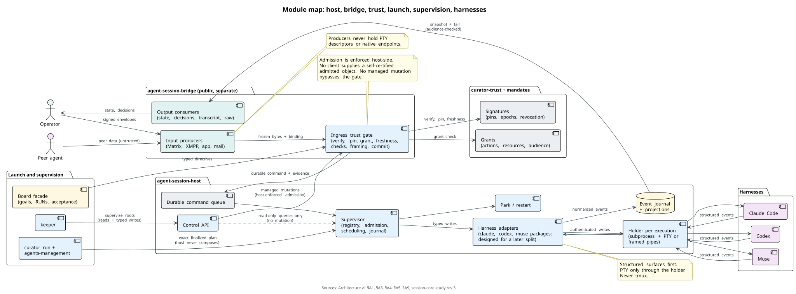
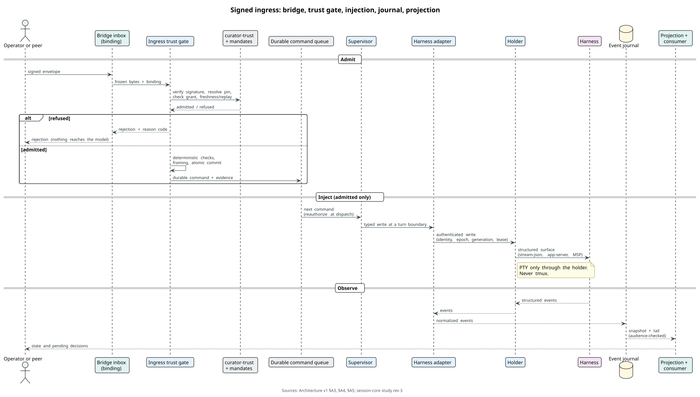
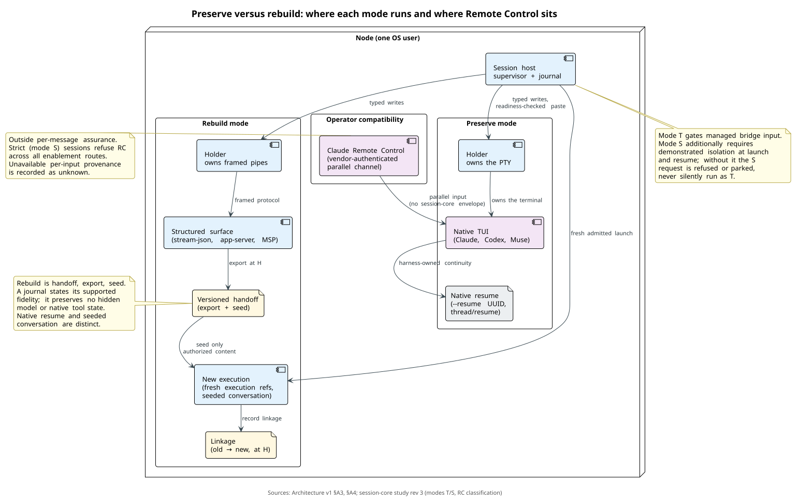
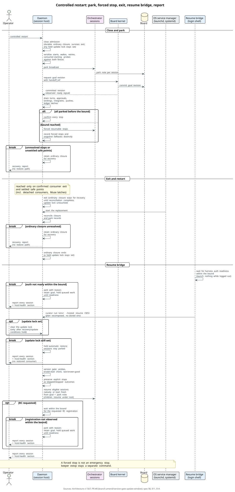

# Session host: specification

Status: **DRAFT v0.3**, 2026-09-27. Not normative. Track: [`track.md`](track.md). Diagrams: [`../diagrams/`](../diagrams/README.md). Command-line shape: relux-works/wiki `research/cli-shaping-review.md`, adopted 2026-09-27. Change logs: §17 (v0 → v0.1), §18 (v0.1 → v0.2) and §19 (v0.2 → v0.3).

A long-lived orchestrator needs something to keep it running when nobody is looking. That program:

- starts a harness in the right directory with the right goal;
- lets a person attach and watch;
- delivers messages into the session;
- reports what happened.

Today that program is `tb-sessiond`, the Session Manager inside task-board. It works, but three things limit it:

- it is fused into task-board;
- it holds Claude sessions in its own address space;
- it only serves one board's primary session and that board's tracked runs.

This specification describes the host as its own module. The module is first extracted as it is (the retained as-is alternative, pending open question A-Q1; see §A1), then extended for the main loop that starts and supervises the root orchestrator of every process on a node.

Three markers say how settled a statement is:

- *decided (date)*: the operator confirmed it;
- *proposed*: the author's resolution, open to review;
- *fact*: a description of the current code, with its source.

Sources of facts:

- relux-works/skill-project-management at `origin/main` `9f594dba`. Paths below are relative to that repository unless stated.
- relux-works/agent-session-manager-spec at `32b3f2b` (`ax` v0.7.0).
- relux-works/curator-spec Decisions 0013, 0019 and 0021 at `origin/main` `3d2c611`.
- relux-works/waggle `spec/waggle.md` §10 at `origin/main`.

Related specifications:

- the process-configuration specification (relux-works/curator-playbook): one root orchestrator per process and the board goal;
- the trust specification (relux-works/curator-trust `spec/trust.md`): who counts as a person, presence-bound confirmations, and running agents under an operating-system account of their own;
- the main-loop specification (relux-works/curator-keeper);
- waggle (relux-works/waggle): the doorbell's delivery modes and the carrier of messages between orchestrators;
- Agent Session Manager (`ax`, relux-works/agent-session-manager).

## Names used in this specification *(decided 2026-09-25)*

People read about the system in the Apiary names. Beekeeping words appear only where people type them in the apiary: the `keeper` command and its nouns (`keeper hive …`), the apiary's directories and the profile name `apiary`. Specifications, code, the host's and the kernel's command lines, flags, configuration keys and board items use technical terms; the same rule stands in the main-loop specification (Names) and in the process-configuration specification §16 *(decided 2026-09-27)*. This is the map; the rest of this document uses the technical terms.

| Apiary name | Technical term | What it is |
| --- | --- | --- |
| apiary | the system | everything one owner runs: all nodes, processes and operators; the smallest apiary is one node |
| yard | node | one machine |
| keeper | main loop | the node's master orchestrator: routes a person's requests, starts and supervises the root orchestrators |
| hive | process | one domain with its own directory, board and exactly one root orchestrator: a family calendar, a café, a hobby project |
| queen | root orchestrator | the one orchestrator started from outside a process; its hosted session is the root session |
| comb | board | the process's board; its cells are the tasks |
| bee | run | one agent run of a role; a goal-bound run is hosted as an owner-run session |

---

## 0. The design on one screen

- **What it is.** The session host keeps agent sessions alive in the background. It starts a harness in a given directory with a given goal, lets a person attach and detach, delivers messages into a session (the doorbell) and reports events. *fact for today; the module is decided* Around it stand the bridge (input producers and output consumers) and the trust gate (signatures and grants on curator-trust plus mandates). *module map decided (2026-10-05); Architecture v1 §A1*
- **Phase 1: under review.** The 2026-09-24 decision extracts the provider-host plane as it is, with no behaviour change. Architecture v1 proposes hybrid (c) instead: a new minimal core with a compatibility facade and selectively ported adapters, built in the private fork and merged back when proven. *extraction decided (2026-09-24), priority; hybrid (c) decided (2026-10-05); the SH1 disposition is open question A-Q1* Everything after §3 stays architecture for later phases either way.
- **One host per node.** One supervisor per OS user and security domain supervises every session: the main loop's and every root orchestrator's. Each execution gets its own holder, so compatible sessions survive unplanned daemon loss and the new host re-adopts them. *proposed; Architecture v1 §A2*
- **Access control.** Today one bearer token, which any process of the operator's user can read, controls every session. The target:
  - peer-credential checks;
  - a capability token per session: a session acts only on itself and its own children;
  - a supervision matrix;
  - operator commands backed by the operator's own authority.

  *proposed; closing access is the first refactor after the extraction, decided (2026-09-25); §6 is the interim step* The v1 authority is managed input as exact-byte signed envelopes checked against grants on curator-trust plus mandates. *direction decided (2026-10-05); mechanics proposed; Architecture v1 §A3*
- **Doorbell modes.** `next_turn` is the default. `steer` puts the message into the running turn where the harness can take it. `interrupt` is only for halt, park and emergency stop. Delivery no longer waits for an attached client. Every managed delivery passes the trust gate. *modes proposed; the gate decided in direction (2026-10-05)*
- **Park and emergency stop.** Park is the orderly stop. The host broadcasts a park request. Each orchestrator writes a note, the note is bound into the board goal through `handoff_ref`, and that revision is the ready signal. The daemon restarts after all sessions parked or were forced at the bound. *protocol decided (2026-10-05)* The emergency stop stays a separate, unmistakable command for when there is no time: `keeper estop [<hive>]`, over the host's `curator session estop`. The kernel adds only a snapshot, `task-board board snapshot`, and no kernel command parks or stops a session or the node. *commands decided (2026-09-27); the emergency stop's mechanics proposed*
- **Its command line.** The host is a Curator provider, `curator-session`, so people and tools reach it as `curator session list|show|status|attach|watch|park|stop|estop|logs|doctor|restart`, and keeper fronts it (§12.1). `task-board session` stays an alias for one release after the node host lands, and its context-registry commands move to `task-board context`. Phase 1 changes no command. *decided (2026-09-27)*
- **A session is a cache.** The goal, the handoff note and the board carry the work across compaction and restarts. Adapters report context and limits so that a handoff is written before compaction. Preserve keeps harness-owned continuity. Rebuild moves it to the host through the journal and a versioned handoff. *proposed, not the first priority; Architecture v1 §A4*
- **One entry point after a reboot.** `keeper up`, started at login, brings the host, the main loop and every root orchestrator back. Resume runs through a login-shell bridge that waits for harness auth, verifies Remote Control registration, and reports every session. *bridge and readiness decided in direction (2026-10-05); the keeper fronts proposed*
- **Conversation and watch.** `keeper` alone opens the main loop's session. `keeper chat` with no target lists every session and opens a conversation with the chosen one; `keeper watch` only looks. Underneath all three are the host's `curator session attach`, in control mode, and `curator session watch`, read-only. *proposed; the command names are the operator's (2026-09-25)*
- **Harness versions.** The default is optimistic: run from a content-addressed cache, capability and resume probes, a known-bad feed, and last-known-good fallback. Strict and pinned are opt-in. Muse is no exception. *decided (2026-10-05); Architecture v1 §A8*
- **Terminal surfaces.** Structured control comes first. A native TUI runs only under an authenticated holder. tmux is excluded: never tmux. *decided (2026-10-05); Architecture v1 §A4*

## Architecture v1 (2026-10-05, for review)

This section is the review package for Ivan and Alexey. It sets the v1 direction. It decides module boundaries, the trust model, and the default policies. It leaves implementation to later change requests. No implementation code is included.

Three markers say how settled a statement is: *decided (2026-10-05)*, *proposed*, and *fact* with its source. The older sections below stay for reference. Where they conflict with this section, this section wins for review. Superseded parts are marked at their sections.

Sources: the session-core study, [revision 4 in the wiki](https://github.com/relux-works/wiki/blob/44fae997e2807c18b2288cec3bc7c5ed781546c3/research/2026-10-05-session-core-study.md) (revision 3's accepted direction plus publication fixes; supersedes rev 2 and rev 3); the design inputs of 2026-10-05; the hosted launch contract r6 plus the operator decisions of 2026-10-05; the decision record on resume and key storage ([PR #9](https://github.com/relux-works/agent-session-host/blob/a6fd2ba639507796642a97d217878c0c6c5a4b90/spec/decisions/2026-10-05-resume-without-persisted-env-and-key-storage.md): relux-works/agent-session-host, branch `decision/resume-env-and-key-storage`, commit `a6fd2ba639507796642a97d217878c0c6c5a4b90`, `spec/decisions/2026-10-05-resume-without-persisted-env-and-key-storage.md`); the [PR #8 amendment text](https://github.com/relux-works/agent-session-host/blob/4d70825ba230f8f9063881efb2cf210bbfa8ee11/spec/session-host.md) (relux-works/agent-session-host, branch `amend/version-gate-update-window`, commit `4d70825ba230f8f9063881efb2cf210bbfa8ee11`, `spec/session-host.md` §§8.1, 8.2, 11, 14 and §15 open questions 14–21); the environment manager revision 2 (cross-reference); the extraction plan revision 2 (orchestrator estimate). Diagrams: `module-map`, `signed-ingress`, `controlled-restart`, `preserve-rebuild`. Both PR #8 and PR #9 artifacts live on those separate branches, not on this branch; this branch carries no §8.1/§8.2 text and no `spec/decisions/` directory. Vendor-contract input: the accepted study relux-works/wiki@d6cc5fc5c7e36785be67347e6d683e18d6190518:research/herdr/vendor-contract.md (§§D.1–D.9, G).

### A0. Invariants (decided by Ivan 2026-10-05, R200)

- **I1. Cryptography and verification of session input.** Every managed input into a session is cryptographically verified before it can act. *decided (2026-10-05)*
- **I2. No process can simply write into a session.** A state report is an observation channel, never a command path into the session. *decided (2026-10-05)*
- **I3. Scale to large swarms.** The design holds for large swarms, not only for one session. *decided (2026-10-05)*
- Every module section below (§§A1–A12) preserves I1–I3. Vendor-contract support (§A12) never weakens them: it is observation only. *decided (2026-10-05)*

### A1. Module map

- `agent-session-host` holds the supervisor, the holder, the registry, the control API, and park/restart. *decided (2026-10-05)*
- Harness adapters live in the host as packages. Each package is designed for a later split. *decided (2026-10-05)*
- `agent-session-bridge` is public and separate. It holds input producers and output consumers behind the trust gate. *decided (2026-10-05)*
- Producers never hold PTY descriptors or native endpoints. *decided (2026-10-05)*
- Signatures and grants build on `relux-works/curator-trust` plus Alexey's mandates. No new trust library is built. *decided (2026-10-05)*
- The build vehicle is hybrid (c): a new minimal core with a compatibility facade and selectively ported adapters. *decided (2026-10-05)*
- Hybrid (c) is built in the private fork `relux-works/skill-project-management-session-split`. The fork syncs daily. It merges back when proven. *decided (2026-10-05)*
- Whether hybrid (c) replaces the mandatory whole-package SH1, or an as-is compatibility capsule ships first, is open question A-Q1. *proposed*
- Coexistence has one writer per record. Existing records remain on their selected backend. New experimental sessions are explicitly routed. Refused admission never falls through to another backend. *proposed*
- Transfer requires confirmed absence or authenticated custody transfer, and one writer. Imported history keeps its source provenance. Rollback-reader compatibility is proven before mutable state is reopened. *proposed*
- The frozen port and source ownership inventory stays under A-Q1 and A-Q10. This does not settle the SH1 disposition. *proposed*
- Working rule: own design, elegant and secure. Design decisions get research before Alexey joins. *decided (2026-10-05)*
- Planning reference (as-is alternative only): the extraction plan's orchestrator figures price SH1 in its own CI in 2–4 days, consumer cutover in 1–2 days after the freeze, and Claude-primary D4 plus slim restart in 3–5 days after the seam freezes. They do not price hybrid scope. *reference, not a commitment*
- Planning reference (hybrid): the study prices the local proof at 5–10 elapsed days after M0, and the qualified remote/board pilot at 10–18 days with prerequisites ready. That covers M1–M4 plus M5 integration and acceptance. It excludes M5 observation, mode S isolation, hardware enrollment, Windows qualification, and the three-OS demo (a separately staffed 5–7-week draft). No board-main integration before the October 16–19 conference window; use October 19 conservatively. *reference, not a commitment*

### A2. Supervisor and holder

- One supervisor serves one OS security domain on a node. *proposed*
- The supervisor owns the session and execution registry, admission, scheduling, interactions, the journal, and reconciliation. *proposed*
- A small holder owns each execution's subprocess and its PTY or framed protocol pipes. *proposed*
- The holder has no board store, no channel login, no goal semantics, and no grant issuer. *proposed*
- Holder writes require an authenticated controller identity, a controller epoch, an execution generation, and an input lease. *proposed*
- Bootstrap material travels through an inherited descriptor that is excluded from the harness. *proposed*
- A dead supervisor's inherited secret is not enough for re-adoption. Re-adoption needs a separate challenge protocol over a protected installation identity or an OS broker. *proposed*
- On supervisor loss the holder keeps bounded output evidence. It prohibits new managed writes until authenticated reconciliation. *proposed*
- Acknowledged journal offsets free the holder's spool. Saturation yields a visible gap or a controlled pause. *proposed*
- A reboot requires a renewed launch or resume. Claude PTY custody cannot migrate by copying records. *proposed*
- Invoking a signed CLI does not make an agent a human. *proposed*
- The holder owns each execution's vendor-report endpoint (§A12). *proposed*
- The agent is a child of our holder/adapter, and the holder/adapter is its single writer. *position (Ivan, 2026-10-05)*
- Nothing listens near the agent: the holder dials the supervisor with a key from an inherited fd, and there is no control socket in the agent's environment. *position (Ivan, 2026-10-05)* This position is in tension with the vendor-contract transport option (a), a telemetry-only listener (§A12); if Ivan picks (a), it would be the single stated exception, and the interim default stays `off`.
- Sessions live as long as possible, ideally surviving a daemon restart underneath them: per-execution holders hold the PTY or stdio pipes, with authenticated re-adoption. *position (Ivan, 2026-10-05)*

### A3. Assurance modes and the gate guarantee

- "Unverified input never reaches the model" holds only within a declared mode. *decided (2026-10-05)*
- Mode T is transport admission. All managed bridge input is gated: signature, pinned identity, grant, freshness and replay, deterministic checks, optional guard, framing, commit, and dispatch reauthorization. *decided (2026-10-05)*
- Mode T does not certify native tool output, files, shell output, hooks, workspace configuration, resumed history, subagent returns, or MCP content. Those stay outside the guarantee, stated plainly. *decided (2026-10-05)*
- Mode T authenticates submitters. It does not certify instructions inside an allowed peer's valid message. *decided (2026-10-05)*
- Mode S is constrained cross-owner execution. Every model input and every sensitive effect is inventoried and mediated, or explicitly refused. *decided (2026-10-05)*
- Mode S requires demonstrated tool, process, and credential isolation at launch and at resume on each OS. The required assurance is bound to the admitted session and launch policy. *decided (2026-10-05)*
- Without that evidence an S request is refused, or the session stays parked. It never silently runs as T. Mode T is a supported explicit operator choice only. A deliberate S-to-T policy change needs separate authorization, an audit record, and re-admission of affected work. S-only authority is never inherited. If isolation fails on an already-running S session, the session is fenced and parked. It is never downgraded silently. No sandbox implementation is mandated here. *decided (2026-10-05)*
- A trusted import service may attest one immutable import by digest, source, and policy revision. That never proves the original author's identity. *proposed*
- The verifier's refusal to return an unverified body protects that tool's response only. It does not protect bytes already read elsewhere. *proposed*
- System-prompt framing supplements deterministic gates. It enforces nothing. *proposed*
- Each mode documents its closure traces as refused, admitted-as-data, or outside-guarantee. *proposed*

| Trace | Mode T | Mode S |
| --- | --- | --- |
| Unsigned local file returned by a native read | Outside guarantee; may reach the model as tool output | Refused, or admitted only as explicitly authorized data with provenance |
| Forged tool-result provenance claimed in chat | Outside guarantee | Refused unless the claimed source re-verifies through the gate |
| Valid peer's signed body instructing credential use or file exfiltration | Managed command admitted as data; the effect depends on native tools, outside guarantee | Effect refused without a matching grant; the credential path is separately refused |
| Resumed hostile history item | Outside guarantee | Refused at resume admission, or quarantined with explicit reauthorization |
| Attempted direct credential use bypassing the domain gateway | Outside guarantee | Refused; the signer broker checks caller, class, target, digest, and approval |
| S launch or resume without isolation evidence | n/a (a separately requested T shows its exclusions) | Refused or parked; no fallback dispatch |

- The board and keeper cross the same admission gate. Their adapter enters the trust gate, not the queue directly. *decided in direction (2026-10-05); wiring proposed*
- Vendor reports are not gate commands. They are execution-local telemetry admitted by §A12; nothing in them reaches dispatch, except the one-directional readiness veto stated in §A12. *proposed*
- Local APIs and model mailbox reads use the same gate. *proposed*
- The gate runs this pipeline at every managed input boundary. *proposed*
  1. Bound and freeze: reject oversized, malformed, ambiguous-version, or duplicate-field envelopes; freeze the exact signed bytes.
  2. Verify the signature: require the expected author and any approver or delegate roles; bind payload, target, action, expiry, message ID, and grant references.
  3. Resolve the pinned identity: validate chain, key epoch, and revocation against an authenticated trust snapshot.
  4. Check the grant or mandate: intersect action, resource, and audience scope with policy, binding, ancestry, and capability.
  5. Check freshness and replay: enforce action-specific expiry; bind `(trust-domain, signer, message-id)` durably to one envelope hash.
  6. Decrypt, then run deterministic content checks: UTF-8, size, type, forbidden controls, quotas, and content rules before any classifier.
  7. Authorize the guard recipient, then the optional guard verdict: before every classifier call, the current privacy/audience policy must authorize the specific guard endpoint and the permitted content or derivative, including retention. Content authorized for the session but denied to the configured classifier produces no classifier submission. `allow` retains the trust class and grants nothing; `deny` refuses; `review` waits for a separately authorized exact-digest release.
  8. Frame and commit: persist the command, the replay binding, the verification evidence, and the audit event atomically; frame third-party content as data with provenance; recheck revocation, expiry, generation, live turn, and interaction revision before dispatch.
- Signature and grant failures never reach any model. *proposed*
- The `(trust-domain, signer, message-id)` to envelope-hash binding is reserved durably. It survives guard failure, pending review, and rejection. States are in-flight, review, refused, accepted, completed, and unknown. *proposed*
- An exact duplicate returns the stored outcome and evidence. It never creates a new admission. Changed bytes conflict. *proposed*
- Uncertain native delivery is reconciled before any replay. A completed duplicate returns cached evidence. *proposed*
- Retention and expiry are defined so deletion cannot resurrect a valid action. Clock rollback, backup restore, snapshot rollback, key rotation, and tombstone cleanup behave conservatively: uncertain state fences and parks. *proposed*
- On a waggle-compatible path the sender and recipient ordering check is preserved. A different order contract in a new namespace is documented with its allowed unordered classes. *proposed*
- An enabled required guard that times out or returns malformed output refuses delivery. A review release re-runs classification. *proposed*
- If an enabled required guard cannot operate within the authorizing policy, the host refuses or parks, or uses a separately authorized local guard. It never silently bypasses the guard. Policy and recipient provenance are recorded without secret-bearing audit bodies. The enabled-guard contract stays pinned model/policy, closed verdict schema, no tools, bounded time and fail-closed. The guard stays optional by configuration. *proposed*
- Acceptance trace (a requirement for later qualification): session-authorized content denied to the configured classifier produces zero classifier submissions and the prescribed refusal/park or separately authorized local path. An allowed derivative exposes only its authorized content. *proposed*

### A4. Injection per harness

- Structured surfaces come first. *decided (2026-10-05)*
- Rebuild versus preserve is a session policy and a launch-contract decision. It is never a hidden optimization. Each mode is a separately negotiated capability (see §A9a). Unsupported combinations refuse. None widens hosted r6. *proposed*

| Harness / mode | Injection surface | Required qualification |
| --- | --- | --- |
| Claude rebuild | Persistent stream-json stdin/stdout, or a supported SDK control path | Module-composed mode, permission response semantics, versioned handoff |
| Codex managed | App-server `turn/start`, `turn/steer` with the expected turn, interrupt, and typed interactions | Module-owned host/client/thread bundle; no raw native endpoint for clients |
| Muse rebuild | MSP `muse serve` with typed session, turn, and permission methods of the admitted release | Accepted MSP adapter, consumed-schema compatibility, fail-closed dispatch |
| Preserve | Native TUI under an authenticated PTY or ConPTY holder | Qualified prompt readiness and safe paste; exclusive human terminal lease; no blind Enter |

- Whole prompts serialize at next-turn boundaries. *proposed*
- Steer requires an exact active turn and a declared capability. *proposed*
- Interrupt has its own control lane. *proposed*
- An authorized halt is executed by the supervisor. It blocks queued ordinary writes. *proposed*
- Approval answers bind the native request, the session, the execution, the revision, and the permitted answer. The first valid authorized CAS wins. *proposed*
- Replay never activates historical approvals. *proposed*
- Raw terminal access is a separate broad human capability. It is disabled by default. Its exclusive lease suspends conflicting automated injection. *proposed*
- Raw access cannot mediate per-action semantics like typed approvals. That limitation is explicit. *proposed*
- A PTY write is not proof of native application. Preserve readiness is requalified anew: approval dialog, partially typed prompt, changing screen, deferred goal acknowledgement, cancellation after paste, stale terminal lease. *proposed*
- Goal-marker checks are never weakened to gain generic messaging. *proposed*
- A sidecar structured process must not masquerade as controller of another TUI session. *proposed*
- Never tmux: its socket gives any reachable caller broad terminal control. *decided (2026-10-05)*
- Rebuild continuity is handoff, export, and seed, not only structured transport. Preserve keeps harness-owned continuity. Rebuild moves it to the host through the journal and a versioned, provenance-bearing handoff. *proposed*
- Agent identity and logical-session identity are stable across rebuild. Execution ID and native-session references are fresh per execution. The handoff digest and version bind to a committed journal boundary (high-watermark H) and to an old-to-new execution linkage record. *proposed*
- The rebuild lifecycle is: observe limits through `context_usage`; drain new work; settle turns, interactions, and effects; commit a versioned, provenance-bearing handoff at H; obtain a fresh admitted launch plan; start a new execution; seed only authorized handoff content; record the linkage and resume admission. *proposed*
- Goals stay with their integration owner. Carried instructions are reauthorized. Old commands and approvals are never replayed as new work. Native resume and a new seeded conversation are distinct identities. *proposed*
- Adapters declare `context_usage`, `Export`, `Seed(handoff)`, native resume, and conversion separately. *proposed*
- Holder-survival qualification for survivor custody is a separate dependency. It never gates the portable rebuild skeleton. *proposed*
- The pilot fidelity is an explicitly bounded authorized transcript or summary plus references to externally owned goals. If that contract is not frozen, rebuild is unavailable. *proposed*
- A journal or summary does not preserve hidden model state, arbitrary native tool state, or exact cross-harness behavior. The first version states its supported fidelity. *proposed*
- The §10 board-compaction handoff writes a goal note and keeps the same session running. It is not the rebuild contract. *proposed*

| Rebuild stage | Owner and evidence | Outcome on interruption |
| --- | --- | --- |
| Before handoff commit | Old execution owns; no linkage | Retry or abort; the new execution never starts |
| After commit, before launch | Handoff committed at H | Fence old writes; launch new or park; never resume old writes |
| After launch and seed, ack uncertain | Seed application unknown | Reconcile native evidence; on unknown, fence and park; never blind-retry the seed as new work |
| After linkage recorded | New execution owns | Old execution retired; resume admission complete |
- Native Claude Remote Control is a vendor-authenticated parallel input channel into the running session. It is not a write through our holder and carries no session-core envelope or presence evidence. *fact (vendor docs, checked 2026-10-05)*
- Remote Control is an operator compatibility capability for the operator's own account. It stays outside per-message session-core assurance. Native RC is never inside session-core per-message assurance. *decided (2026-10-05)*
- Strict (mode S) sessions declare Remote Control unsupported and refuse it across all enablement routes, not only launch argv. Preserve-compatibility sessions may allow it with the tradeoff explicit. *decided (2026-10-05)*
- A holder lease governs host injection only. It does not govern the vendor parallel input channel. Exclusivity and revocation below scope host-managed writes only, unless a separately qualified mechanism disables RC. *proposed*
- Audit records Remote Control input with vendor provenance, distinct from admitted host commands. When native evidence cannot identify the source, provenance is recorded as unknown or unattributed. It is never invented. *proposed*

| RC path | T plus RC (compatibility) | S |
| --- | --- | --- |
| Initial flags and auto-start | Allowed when declared; audited as vendor-origin | Refuse S plus RC unless RC exclusion is demonstrated for this path |
| Manual in-session enablement | Allowed; host lease and revocation still scope host writes only | Same refuse rule |
| Reconnect and resume, including after supervisor loss | May continue outside host authority; record vendor or unknown provenance | Refuse unless exclusion is demonstrated |
| Exclusive managed lease | Scopes host writes only; does not disable RC | RC unsupported; refuse |
| Local revocation | Closes host dispatch; RC continues unless separately disabled | Refuse |
| Permission race (typed card pending, RC resolves natively) | Native resolution invalidates the pending card as externally resolved; never recorded as host-authorized; the stale card closes with vendor or unknown provenance | Refuse |

- Vendor telemetry can only veto injection within a freshness window; it never satisfies readiness. Native readiness evidence, the terminal lease, and the execution epoch stay independent of it (§A12). *proposed*
- Every input is an admitted command with an exact-byte signature, verified at the host gate before the adapter. *position (Ivan, 2026-10-05)*
- Codex uses a shared app-server: the native TUI (`codex --remote … resume`) and our host drive one engine through a local gateway, so preserve and structured coexist. Messages go via `thread/queue/add` with a client message id; `turn/steer` is separate. *position (Ivan, 2026-10-05)*
- Claude preserve keeps the live TUI with RC alive. Injection happens only through our holder, only for admitted signed commands, only when the prompt is ready, and never with a blind Enter. Switching to stream-json via native resume is an explicit mode change, because it ends the TUI process and RC with it. *position (Ivan, 2026-10-05)*

### A5. Output journal, projections, and audit

- Structured events flow through a normalizer into a transactional journal. *proposed*
- Preserve adapters additionally read native history for the exact native identity. *proposed*
- PTY stdout is a screen stream, not a conversation transcript. *proposed*
- Readers retain offsets and format/version checkpoints. Rotation, incomplete records, and unsupported events stay visible. *proposed*
- Events carry session/execution, source identity/sequence, controller and stream generation, actor provenance, causation, timestamp, and audience. *proposed*
- Native order, UI cursor, transport ID, and workflow revision stay separate. *proposed*
- The journal event and the outbox pointer persist together. *proposed*
- A snapshot at high-watermark H precedes the tail after H. *proposed*
- Reconnect replays retained events or returns an explicit gap or reset. *proposed*
- The first projections are deterministic: running, waiting, error, decision. *proposed*
- A digest consumer has limited read scope. It returns source cursors, reducer/model version, and uncertainty. *proposed*
- The default remote view shows state and pending decisions. Raw transcript stays behind a distinct permission. *proposed*
- A summary cannot issue approval, prove completion, or broaden audience. *proposed*
- Egress repeats audience and grant checks plus secret filtering, then authorizes the specific guard endpoint and the permitted content or derivative including retention, before the optional outbound guard, encryption, and service signing. Content denied to the configured classifier produces no classifier submission. *proposed*
- Redaction creates a separately signed derivative referencing source digests. *proposed*
- Cursors and exports bind to audience and policy, rechecked at delivery. Revoked subscriptions close. Delivered plaintext cannot be recalled. *proposed*
- New acceptance is refused when durable storage fails. A bounded emergency control path and bounded inbox/outbox/blob storage are an unresolved parameter: the host owner must define them (see A-Q11) before the corresponding capability is enabled. *decided policy: fail-closed storage; bounds unresolved*
- Secret-bearing native evidence stays in protected storage with its own retention policy. Audit records hold digests, decisions, and provenance. *proposed*
- Decisions render from typed live state. Hostile HTML and terminal control are rejected in the UI. *proposed*
- Secret filters are best effort. *proposed*
- Audit uses a domain-separated hash chain over canonical records. Records carry sequence, previous hash, digests, actor/key/grant IDs, policy revision, admission/dispatch outcome, guard version, execution, and receipt. *proposed*
- Checkpoints are signed and optionally witnessed remotely. The chain is verified on reopen. Recovery gaps are recorded. *proposed*
- Hashes expose alteration relative to a retained head. They do not stop a disk owner replacing an unwitnessed whole history. *proposed*
- Receipts distinguish durable acceptance, dispatch, native application evidence, and rejection. *proposed*
- A crash after a PTY write can leave `outcome_unknown`. Native evidence is reconciled before replay. *proposed*
- Process exit and turn completion do not establish board acceptance. *proposed*
- Every admitted vendor report is a journal event `{exec, source, seq, agent, state, message, peer facts, assurance, decision, n}` admitted as `queued` (or `coalesced` under pre-acceptance backpressure) and covered by durable commit or crash-gap recovery; a complete payload receipt exists only for a `durably_committed` record, gaps attest ranges and reasons, never omitted payloads or a known count of lost reports; one commit format carries an exact partition of positions per execution from a genesis anchor, refusals are aggregated, and the audit chain covers batches, retention anchors, and checkpoints (§A12). *proposed*
- Output from a TUI comes from the native transcript, read-only: Claude hooks give transcript path and timing; Codex uses rollout files or the app-server subscription; Muse uses its session log or MSP. It flows adapter → our journal (seq, cursor) → bridge → any destination, with per-binding egress policy and signed receipts. No screen scraping. *position (Ivan, 2026-10-05)*

### A6. Key lifecycle

- Operator presence keys, host/controller keys, agent/service keys, and encryption keys stay separate. *proposed*
- An agent introduction binds stable identity, parent, purpose, epoch, and host. *proposed*
- Agents never get the root seed. Derived identity inherits no broad authority. *proposed*
- The host's own keys sit in a 0600 file in a backup-excluded directory, read through a pluggable key provider. *decided (2026-10-05); record: PR #9*
- Tests use an injected provider. No test touches a real keystore. *decided (2026-10-05)*
- Keychain and other OS keystore providers are follow-up design after stable code signing. *proposed*
- Keys pin through nonce-bound short-lived pairing with proof of possession and out-of-band fingerprint confirmation. *proposed*
- Rotation needs continuity evidence plus updated revocation and grants. *proposed*
- Recovery without the old key requires explicit re-enrollment. *proposed*
- Signer brokers check caller, act class, target, digest, and approval. They never sign arbitrary model-supplied bytes. *proposed*
- Compromised-key revocation cascades down certification descendants. Planned retirement leaves descendants valid. *proposed*
- Checks are chain-wide with enrollment and attestation evidence. *proposed*
- An old-key signature on a new key is continuity evidence, not immunity from theft. *proposed*
- Recovery needs an independently authorized anchor and a visible trust change. *proposed*
- Offline revocation bounds and fencing for admitted work are an unresolved parameter: the trust owner must define them (see A-Q6) before the corresponding capability is enabled. No design promises instant remote revocation while disconnected. *decided policy: fail-closed limitation; bounds unresolved*
- Static keys imply no historical confidentiality or forward secrecy. *proposed*
- Critical acts require per-act presence bound to the act digest. Secure Enclave residency alone is not presence. *proposed*
- The verifier distinguishes `fido-uv`, `attested-app`, and `local-os`. *proposed*
- An unattended host key or 0600 file is not a human presence key. *decided (2026-10-05)*
- The vendor-report receipt key is a host principal key under this lifecycle; the checkpoint key belongs to the roster keeper. Routine rotation retires; suspected exposure goes through a compromise record with a last trusted checkpoint prefix; verification needs a fresh authenticated roster head (§A12). *proposed*

### A7. Park, restart, and reboot

- The host broadcasts a park request into every session. Board sessions park through a goal revision (see below). Plain-session park semantics are open (see §A9a). *decided (2026-10-05)*
- Each session finishes its turn, writes its park note, and binds it through a goal revision with `handoff_ref`. The kernel commits that revision. The daemon observes the committed reference. That observed revision is the ready signal. *decided (2026-10-05)*
- The daemon restarts after all sessions parked or were forced at the bound, and only on confirmed consumer exit with settled safe points. Unresolved stops retain the closure and report recovery. They never enter the restore path. *decided (2026-10-05)*
- A note deadline is not a drain deadline. Drain waits for turns, approvals, landings, integrates, pushes, and ledger latches, including detached consumers and Muse latches. *decided in direction (2026-10-05)*
- The emergency stop stays a separate command. A forced stop is not an emergency stop. *decided (2026-10-05)*
- Mechanics are carried by the PR #8 text (branch `amend/version-gate-update-window`): the optimistic version gate (§8.1), the slim update window (§8.2), the resume bridge (§11), and the controlled restart (§14). *reference*
- A controlled restart closes admission before the park broadcast and serializes that ordinary closure with starts, wakes, retries and consumer-starting probes. An existing durable update lock stays set through park, exit, replacement and reconciliation; it never blocks the ordinary closure. The ordinary closure ends on its own successful reconciliation without clearing the separate update lock. Otherwise it is retained for recovery. The operator clears the update lock immediately before eligible restore, after the recovery/update conditions hold; while it stays set, no consumer is restored. Under the closed clearing rule below, this operator-clear sentence describes only the permitted operator-only v1 profile and failed/unknown recovery: in an auto-clear implementation verified success clears inside its update transaction, and ordinary reconciliation never clears the separate update lock. *PR #8, proposed*
- At the bound the daemon records forced resumable stops and snapshot fallbacks distinctly. Unconfirmed stops keep the closure for recovery. *PR #8, proposed*
- The OS service manager (launchd/systemd) restarts the daemon after replacement. It is distinct from the host supervisor in §A2. *PR #8, proposed*
- Resume uses the login-shell bridge with no persisted environment. The launcher recomposes the plan from the profile and the login environment. *decided (2026-10-05); record: PR #9*
- A missing required variable parks the session with `required_env_missing` and names it in the report. *decided (2026-10-05)*
- Restore waits for harness auth readiness within a bound and launches nothing while logged out. The resume launch runs only after auth succeeds and only for eligible sessions. Auth or RC failure parks with a bounded reason, retains the goal, and holds queued work until readiness. It never clears the goal. Restore covers only eligible sessions. Explicit stops are preserved as skipped/stopped outcomes. Children resume under their root. *PR #8, proposed*
- The full permission posture comes from the plan, including deny lists. Flags are never reconstructed. *PR #8, proposed*
- Where Remote Control is requested, restore launches the session first, then waits within a bound for the requested registration before reporting success or queued delivery. *PR #8, proposed*
- The report covers every session plus a host-health section. No session disappears silently. *PR #8, proposed*
- Login restore runs only after a fresh boot. Manual restore works at any uptime. *PR #8, proposed*
- Reboot restore installs nothing. Pending updates use the planned window under the durable node-wide lock. *PR #8, proposed*
- A vendor `resume_argv` hint is shown at resume and compared with the plan; resume still runs through the launcher and the version gate (§A8), and counters and anchors behave as §A12 says. *proposed*
- The update lock clears automatically inside the same update transaction after VERIFIED success: the update record proves the new component runs, its probes pass, and state is compatible. After a failed or unknown outcome the lock stays, survives restarts, keeps every auto-start off, and only the operator clears it. V1 may ship operator-only clearance; auto-clear on proven success is the target, not a blocker. *position (PR #8 owner, 2026-10-06); the clearing rule is closed*

The diagram above depicts the operator-clear path (operator-only v1 / failed-unknown recovery); it does not restrict the auto-clear target. *clarification under the closed clearing rule*

### A8. Harness version policy

- Harness versions are optimistic by default. *decided (2026-10-05)*
- A new build runs when it passes authenticity where published, capability and resume probes, and the known-bad check. *decided (2026-10-05)*
- Sessions run from a content-addressed cache. Copy on first use. Resolve by hash, never by PATH. *decided in direction (2026-10-05)*
- The cache keeps two or three last-known-good builds by hash. Protected references always win over retention targets. *decided in direction (2026-10-05)*
- Probe, launch, or resume failure triggers one automatic retry on an eligible last-known-good build. Cleanup of the failed attempt is confirmed first. *decided in direction (2026-10-05)*
- Our sessions never execute a bad-listed build, including a cached fallback. *decided (2026-10-05)*
- Strict verification and pinned versions are opt-in. They stay subject to the known-bad check. *decided (2026-10-05)*
- Muse follows the same optimistic default. It is not an exception. *decided (2026-10-05)*
- The MSP probe checks schema compatibility for everything the host consumes. Additions are allowed. The runtime stays fail-closed. It also replays a short real Echo turn against the PTY grammar. Unknown records or screens refuse or defer. *decided in direction (2026-10-05); probe clause: PR #8 (branch `amend/version-gate-update-window`)*
- Safe MSP additions stay allowed. Exact fingerprint and release pins stay opt-in. The superseded strict Muse default is not restored. *decided (2026-10-05)*
- A version change is caught for every session on resume. Success sends an `updated X→Y` notice and records both identities. *decided in direction (2026-10-05)*
- The environment manager owns retained closure selection, authenticity and probe evidence, and known-bad policy. *reference: the environment manager revision 2*
- Every Start re-admits the selected identity under the durable node fence. Content identity stays distinct from execution identity. *reference: the environment manager*
- Last-known-good fallback needs absence or completion proof plus compatible mutable state. Uncertainty parks. *reference: the environment manager*
- The permission default is yolo unless configured. An explicit flag wins. The tracked-yolo refusal is removed for the hosted path. *decided (2026-10-05)*
- Yolo harness permissions do not authorize external senders. They do not weaken bridge admission. *decided (2026-10-05)*
- The operator hosted default is honored: `host: hosted` in the operator's curator-run-defaults is the operator's own opt-in. *decided (2026-10-05)*
- Machine defaults wait for the controlled restart, not for a no-hangup upgrade. *decided (2026-10-05)*
- Hosted Codex is judged by result: model, effort, permissions, MCP, profile env, network. Only enumerated transport differences are allowed. *decided (2026-10-05)*

### A9. Fit with curator run, keeper, the board facade, and the swarm

- Curator run stays the launch entrypoint. *proposed*
- Profiles select environment, permissions, MCP, and bridge bindings. Agents-management owns native grammar and variants. *proposed*
- A bridge profile binds session reference, transport endpoint, channel, message classes, ingress mode, grants, audience, projection, retention, and budgets. *proposed*
- A project profile cannot widen operator grants or publish private transcripts. *proposed*
- The host imports the exact finalized plan and validates it. It never composes a second plan or reconstructs denied flags. *proposed*
- Network policy is applied by the actual process owner under its negotiated contract. This section makes no network changes. *proposed*
- Keeper routes human decisions and supervises registered roots. It holds no terminals. *proposed*
- `keeper up`, `keeper down`, `keeper park`, `keeper estop`, `keeper chat`, and `keeper watch` front the host's operations (§12.1). *decided (2026-09-27); retained*
- The board and playbooks keep workflow truth: the goal ledger with CAS, RUN lifecycle, acceptance, context selection, and repository activity. *proposed*
- Their adapter supplies typed directives through the trust gate and consumes exact acknowledgements. *proposed*
- Deferral, pending acknowledgement, and rollback stay transactional. *proposed*
- The swarm stays a coordination producer. Its relayed bodies, including relayed owner decisions, are untrusted peer data. *proposed*
- The strict path verifies signed envelopes before inbox content reaches the model. Matrix identity alone does not satisfy it. *proposed*
- The bridge keeps one mailbox consumer and metadata-only coalesced doorbells. *proposed*
- A stable application origin and command identity is retained through carrier wrapping and authorized derivatives. It is deduplicated across bindings. Reflected output is rejected as new input. *proposed*
- Origin, transport ID, signer, and journal cursor stay distinct. *proposed*
- Acceptance traces: one event arriving over Matrix and XMPP produces one command; mirrored output produces no new command. *proposed*
- Unresolved carrier mapping details stay under A-Q8. *proposed*

### A9a. Hosted-contract compatibility (r6 boundary)

- Hosted r6 stays board-primary. Boardless launches refuse. Versions stay closed. Admission stays independent. The exact-plan rule stays, except for the recorded operator amendments (hosted default, Codex parity, yolo, optimistic versions, resume and key storage). *decided (2026-10-05)*
- Plain sessions and each new native mode are separately negotiated capabilities and schemas. That covers preserve and rebuild per harness, assurance mode, and host-owned continuity. Unsupported combinations refuse. *proposed*
- A PTY plan is never converted to a structured process inside the host. *proposed*
- The §A7 park wording covers board sessions with a goal revision. Plain-session park and handoff semantics, and mode selection, must be defined by the host owner with the launcher owner. Until then they are open (see A-Q3 and A-Q10). *proposed*
- This work links to the host, bridge, and launcher owners and to the retained phase gates. No completed schemas are invented here. Yolo, optimistic versions, and Codex parity open no unrelated gates. *proposed*
- The vendor-report endpoint is a per-launch capability `vendor_reports: herdr/1` with `transport` and `min_assurance`; a plan may disable it (§A12). *proposed*

### A10. Adopted ideas

| Idea | Source | Lands in | Status |
| --- | --- | --- | --- |
| Session bridge with pluggable in/out providers | The 2026-10-02 call, the session-platform draft | agent-session-bridge | Adopted: central write/read seam; producers never hold PTY or native endpoints. |
| Exact-byte signed messages as authoritative input | The 2026-10-02 call, the session-platform draft | curator-trust/mandates | Adopted: freeze bytes; bind target, action, expiry, ID; rewrapped text is a derivative. |
| Action/resource grants and mandates with revocation | The 2026-10-02 call, the session-platform draft | curator-trust/mandates | Adopted: scope intersects policy, binding, ancestry, capability. |
| FIDO presence for critical acts | The 2026-10-02 call, the session-platform draft | curator-trust/mandates | Adopted: per-act UP/UV bound to the act digest; Enclave residency alone is not presence. |
| XMPP first product carrier, Matrix doorbell bindings | The 2026-10-02 call, the session-platform draft | agent-session-bridge | Adopted: one envelope API; carrier login never equals application identity. |
| Agent keys with signed introductions | The 2026-10-02 call | curator-trust/mandates | Adapted: separately generated pilot keys plus introductions; BIP-47-style derivation stays research. |
| `curator run` bridge profile: session-to-channel mapping | The 2026-10-02 call, the session-platform draft | curator run | Adopted: binds reference, endpoint, channel, classes, mode, grants, audience, budgets. |
| Retained runtime closure with re-admission and fencing | The session-platform draft | The env manager | Adopted: probe evidence; last-known-good fallback only on absence/completion proof. |
| Two native surfaces with declared launch mode | hapi | agent-session-host | Adopted: preserve TUI and structured control are different contracts. |
| Permission request → phone decision → native response | hapi | agent-session-host, agent-session-bridge | Adopted: typed approval round trip; discovery never grants write authority. |
| Reconnecting typed event contract; push wakes, app pulls state | hapi | agent-session-bridge | Adopted: shared event schema; push-token possession is not authentication. |
| Durable agent identity with tenant/audience binding | buzz | curator-trust/mandates, agent-session-host | Adapted: stable participant across replacement; the local journal stays authoritative. |
| Agent-side author admission as typed admitted-event | buzz | agent-session-bridge | Adapted: coarse RespondTo precedent; not a grant or presence system. |
| Verify-before-decrypt, immutable snapshots, ID/hash binding, signed receipts | Reef | agent-session-bridge, agent-session-host | Adopted: endpoint discipline for messages and projections. |
| Pinned-model guard contract, fail-closed, exact-digest review | Reef | agent-session-bridge | Adapted: same contract shape, optional rather than Reef-mandatory. |
| Single semantic write gate: accepted/dispatched/applied/unknown | The session-platform draft | agent-session-host | Adopted: retried delivery never blindly retries a native prompt. |
| Relay as source of truth with readable server content | buzz | agent-session-bridge | Rejected: conflicts with E2E; the relay stays ciphertext-only where E2E is promised. |
| HAPI code transplantation | hapi | agent-session-host | Rejected for now: AGPL-3.0; study behavior pending a licence decision. *(historical; superseded by the R200 inspiration-only rule below: the code-reuse direction is closed, and no later licence decision reopens it.)* |
| HAPI I/O topology with trust and certificates | hapi (Ivan's input 2026-10-05; wiki `research/inputs-2026-10-05/hapi-message-path.ru.md`) | agent-session-host | Position (Ivan, 2026-10-05), for joint review: agent as holder child, holder dials supervisor, signed admitted commands; nothing listens near the agent. |

- herdr, Reef, Buzz, and HAPI are inspiration only: no backend, fork, or code transplant is taken from any of them. The adopted rows above are our own designs. *decided (2026-10-05)*

### A12. Vendor reports: herdr vendor-contract support

Input: the accepted vendor-contract study relux-works/wiki@d6cc5fc5c7e36785be67347e6d683e18d6190518:research/herdr/vendor-contract.md, published r5.1 — frozen input. Its §D.9 describes the old `37e70422` mapping; §A12 below plus its local cross-references now own the live mapping and all subsequent amendments (corrections land here, not in the study). Version and conformance maintenance follows study §D.7 under local ownership and never silently substitutes a later upstream contract; study §D.10 stays conditional and separately gated. No herdr backend, fork, or rewrite; our own core. *decided (2026-10-05)*

- The host supports herdr's vendor contract — `report_agent`, `report_agent_session`, `release_agent`, optional `seq`, and the launch environment the transport matrix below sets or strips — so a harness that speaks it works unchanged, within the declared compatibility restrictions. *decided (2026-10-05)*
- A vendor report is an observation-only channel: it changes display state and reported-status waits for that one execution and nothing else. For every report the host keeps three things apart: the self-report (evidence the sender said this, none that it is true); the observed OS facts (peer principal, process identity, membership, with the assurance level the OS primitives actually support); and the host receipt (evidence the host saw and decided exactly this). *proposed*
- One endpoint per execution, owned by the holder. A `pane_id` that is not this execution's id is `pane_not_found`. The endpoint serves the four report methods and `ping` and nothing else; it cannot reach terminal or native input, dispatch, or grants. *proposed*
- Admission is honest about what the OS proves. Qualified admission — the kernel binding the writer's identity to the bytes — exists only on Linux ≥ 6.5, through per-fragment `SCM_CREDENTIALS` plus `SCM_PIDFD` under the complete receive contract (credentials enabled before `listen`, verified per accepted socket, exact control sizing with one spare slot to detect extras, truncation and unexpected descriptors rejected, one sender per request, liveness and cgroup membership re-checked per fragment). macOS and Windows are guardrail overall: the level is the weakest component. The assurance (`qualified` | `guardrail`) is written into the journal event and the receipt, and the launch plan's `vendor_reports.min_assurance` refuses anything below it. *proposed; OS facts per study §D.2*
- Daemon workers outside the harness tree (delegates) are unsupported by default; registration is a gate command, never a listener method, capped at 4 delegates per execution. Membership is never widened to the whole account. *proposed*
- Receipt contract: §A12 adopts study §D.3 as its initial contract; the rules below are normative here, and §A12 owns all amendments. The receipt carries no JSON numbers: every full-precision integer is a canonical decimal string (ASCII digits, no sign, no leading zero except `"0"`; compare by length, then lexicographically). The payload commitment is domain-separated over the retained raw request bytes: `payload_commit = sha256("asr-vendor-report/v1" || 0x0A || decimal(len(raw)) || 0x0A || raw)`, where `raw` is exactly the request line before its terminating `0x0A` (a preceding `0x0D`, if a sender writes CRLF, stays part of `raw`). Canonical bytes are JCS over objects holding only strings, arrays, objects, and `null`; the signature is SSHSIG with namespace `agent-session-host/receipt/v1`. The receipt key is a host principal key held in the holder process only: never in the environment, never in an inherited descriptor, never in the agent's process tree. *proposed*
- Every commit is a batch (`{v, kind, host, batch_n, prev, window, records, gaps, count, t_ms}`) binding records (`{exec, epoch, endpoint, n, method, source, agent, seq|null, payload_commit, peer, decision, t_ms}`, with peer `{os, principal, pid, pid_identity, connector|null, membership, assurance}`) and gaps (`{exec, epoch, n_from, n_to, count, reason: coalesced|crash}`) of many executions to their execution and epoch, chained by `prev` and `batch_n`. `count` is the number of records; every gap has `n_from ≤ n_to` and `count = n_to − n_from + 1`; a gap-only batch is valid, a batch with neither records nor gaps is not. Per execution, positions form an exact partition: every position exactly once, no overlap, no duplicates; a record or gap for an `(exec, n)` already seen in an earlier valid batch is a conflicting duplicate — the batch is rejected and the chain is marked inconsistent from that `batch_n` on, the earlier content stands. Verification of an execution starts at `"1"` after its genesis anchor or at its retention anchor's `purged_through + 1`; a record whose epoch is fenced verifies as historical. Crash gaps cover reserved positions from the durable allocation watermark; the number of reports lost in one is unknown. *proposed*
- An admitted report is `queued` (admitted, position allocated, batch not yet committed), `coalesced` (folded under journal-byte backpressure before acceptance, display still updated), or `durably_committed` (its batch committed; only now does a complete receipt exist). A vendor's `ok` — including a successful one-way shim write — is not durable attestation. *proposed*
- Suspected key exposure goes through the compromise path only: the keeper's compromise record names a last trusted checkpoint prefix established before the earliest possible exposure, coverage is compared against that prefix, with no safe prefix nothing under the key survives. Routine rotation retires with `valid_until` and a retirement checkpoint position. Checkpoints are signed by the roster keeper's `checkpoint` key, held by the keeper service under its own OS account and never by any holder, and appended to the roster's own signed log, whose positions order checkpoints, compromise records, and retirements. A compromised checkpoint key voids later checkpoints under the same prefix rule. A verifier needs a fresh authenticated roster head (keeper-signed, monotonic head sequence, age below the policy maximum); without it the answer is `unknown`, or explicitly historical; key validity is never derived from receipt timestamps. *proposed*
- Lifecycle freshness, one rule for all three lifecycle methods (study §A.4): `report_agent`, `report_agent_session` and `release_agent` share one lifecycle anchor per `source` within the execution. A supplied `seq` must be newer than that anchor; an omitted `seq` is eligible only while the source has no anchor. Freshness is checked before any method effect, and `release_agent` additionally requires a matching `source` and `agent`. The metadata domain is separate (an omitted `seq` there is always fresh), and `clear_agent_authority` stays forbidden. Acceptance: for each lifecycle method an omitted `seq` before an anchor is eligible, subject to the method's other checks; an omitted `seq` after anchor 10 is ignored; 9, 10 and 11 are stale, stale and fresh; interleaved identity, state and release reports from one source consult the same anchor; no hint changes a running session's input or bypasses launch authorization. *proposed*
- Report-only semantics per method:

  | Method | Rule |
  | --- | --- |
  | `report_agent` | Updates display state for this execution; keeps the session reference for every source; lifecycle freshness per the common rule above; unknown `state` values are `invalid_request`, never mapped to `unknown`; `resume_argv` on a report that is not applied is dropped silently. |
  | `report_agent_session` | Identity only: session reference (paths stay identity data) and `session_start_source` normalized as herdr does; no state change; lifecycle freshness per the common rule above, so an unsequenced or stale identity report never overwrites identity behind a newer anchor. |
  | `release_agent` | Applied when `source` and `agent` match the current authority and the common freshness rule holds (with last sequence 10, releases at 9 and 10 are stale, 11 is fresh; an unsequenced release is eligible only while no anchor exists); clears display state and the stored hint. |
  | `report_metadata` | herdr's limits and normalization verbatim (80-char caps, 16 per report, 32 keys, 32 sequenced token sources, TTL 1 ms…24 h, guards, stored-but-hidden presentation) plus the §D.8 total cap of 32 metadata sources; the metadata sequence domain is separate, and a missing `seq` there is always fresh. |
  | `resume_argv` | Validated with herdr's format rules and stored as a hint with provenance (source, agent, seq, receipt `n`); shown to the operator and the launcher. The launcher may use it only for fields the harness adapter allows (for example `--resume <id>`) and logs the decision; never typed into a shell; never supplies an executable, arbitrary argv, or session-input authority — validation is format only, authority comes from the launcher. |
  | `ping` | Report-only identity: our version, the compatible herdr protocol number, and `capabilities.report_only: true`. |

  *proposed*
- `clear_agent_authority` is refused with `forbidden`: administrative reset is a gate command, never a listener method. Anything outside the four report methods and `ping` is `invalid_request`. *proposed*
- Readiness: vendor telemetry can only veto injection within a freshness window; an `idle` report never satisfies readiness, and waits distinguish `reported:<state>` from `completed`. *proposed*
- Lifecycle and anchors (study §D.8; the target of the §A7 reference): vendor sequence anchors, execution epochs, report positions, and the durable allocation watermark are separate things. No process-generation resets within an execution; no anchor eviction and no silent sequence refresh. Park closes the endpoint and reports get a connection refusal; exit or crash closes the endpoint, unlinks the socket, closes open connections, drops delegates, and lets final records ride the next batch; replacement fences the old endpoint — already-open connections receive `stale_pane_target` on their next request and are then closed, the epoch checked per request; resume or replacement creates a new endpoint and a new epoch and resets both vendor sequence domains (lifecycle and metadata), while report positions and the durable allocation watermark stay governed by the receipt rules (study §D.3) and never reset; reboot recreates an empty runtime root and resumes `n` from the durable watermark with a `crash` gap for the reserved positions. An agent restart inside one execution that restarts `seq` at 1 is ignored until it exceeds its old anchor. *proposed*
- Bounds are a design target, not a measured result: designed for 4,096 executions per host, not load-tested. Framing and retained state (study §D.8): frame ≤ 16 KiB — an explicit compatibility restriction (herdr documents no limit and accepts larger lines; the escaped-Unicode oversize case is a conformance fixture); lifecycle sources ≤ 8 per execution, metadata sources ≤ 32 in total, `source` ≤ 128 bytes, `agent` ≤ 64 bytes, `message` ≤ 1 KiB truncated; metadata keeps herdr's character limits counted at 4 bytes per character; retained state ≤ 130 KiB counted, cap 144 KiB enforced (`state_budget_exceeded` before any state change). Per execution: one endpoint, ≤ 2 concurrent connections, 2 s read and 5 s write timeouts, 20 requests/s sustained with a burst of 100. *proposed*
- Aggregate admission and backpressure (study §D.8): 8,192 requests/s host-wide with round-robin fairness, beyond it `overloaded` and counted; journal-byte backpressure before acceptance against a 4 MiB/s complete-record budget — a report arriving while the budget is exhausted is admitted `coalesced` only if its `(execution, source)` already has a record or coalesced position in the current window, otherwise refused `overloaded`; a `queued` report is never downgraded or replaced afterwards. Queues are bounded (pending records ≤ 65,536 or 32 MiB, pending raw bytes ≤ 32 MiB, canonical buffer ≤ 32 MiB, signing scratch ≤ 1 MiB); scheduled batching (1 s window stretching to 4 s) with separate checkpoint accounting; retention 7 days or 20,000 events per execution behind a signed retention anchor; refusals aggregated per `(execution, reason, peer identity)` under the counter rules of the enforcement contract below. *proposed*
- Enforcement contract (study §D.8, adopted in full as A12's initial contract; amendments are owned here, and the accounting items of §G stay open): the frozen §D.8 bounds, allocation inventories, saturation outcomes, retention and audit rules apply. The saturation outcomes are explicit:
  - an oversize frame (over 16 KiB) closes the connection without applying anything;
  - a ninth lifecycle source in an execution is acknowledged, counted and dropped;
  - a 33rd metadata source is refused with `metadata_source_limit`;
  - a third concurrent connection is closed with `busy`;
  - a full queue refuses a new report with `overloaded` before acceptance; it is never accepted and downgraded later.
  Per connection the parsed working set is at most 48 KiB beside the 16 KiB frame; per execution at most two raw requests and 32 KiB are in flight. Refusal, stale and coalesced outcomes are aggregated into one counter event per 60 s, at most 256 keys per execution per hour, then one overflow event; the counter allocation is bounded at 16 KiB. Acceptance traces (document checks, not a load test): a 257th distinct audit key in the hour goes to bounded overflow accounting; a report at a full queue is refused; the ninth-source, 33rd-source and third-connection cases each produce their declared outcome. *proposed*
- Signing, memory, and descriptors are budgets and inventories, not measured results (study §D.8; accounting stays open per item 7 below): ordinary batches ≤ 1 receipt signature/s on average, exits add none (final records ride the next scheduled batch), checkpoint submissions ≤ 1 authentication signature per 64 s plus the keeper's own checkpoint signature from the keeper's budget — an average of ≤ 1.02 signatures/s with a two-signature burst when a batch and a checkpoint submission coincide; worst case ≤ 1.3 GiB (≈ 520 MiB steady) and ≈ 41,216 descriptors at 4,096 executions against `RLIMIT_NOFILE` 65,536, new connections refused `busy` within 10% of the limit. Conformance: the churn test plus the §D.7 kit — escaped-Unicode oversize, payload/canonicalization/position-coverage vectors, verifier rejection cases (duplicate position, overlapping gap, wrong gap count, conflicting duplicate), mixed-sender/truncated/missing-credential/`SCM_RIGHTS` fragments, and the Windows admission matrix. *proposed*
- The launch plan carries `vendor_reports.transport: listener | inherited_fd | off`, negotiated as a per-launch capability under the exact-finalized-plan rule: the host applies the plan's selection and invents no other. Interim host default: `off`, with no automatic fallback; an unavailable or unsupported selection becomes `off` with a journaled reason, never a reason to reject a launch. The final default is pending Ivan: (a) a telemetry-only listener with explicit permission — compatible with stock senders but a listener in the agent's environment, in tension with the position that nothing listens near the agent (§A2); if Ivan picks (a), it is the single stated exception — or (b) an inherited channel with CLI-only senders — literally no listener, but unavailable on macOS and pending qualification on Windows, and supporting no existing sender as written. Both are recorded; neither is decided. *proposed (interim); final default pending Ivan*
- The holder sets and actively strips the launch environment per the transport matrix (study §D.2): `listener` sets `HERDR_ENV=1`, `HERDR_PANE_ID`, `HERDR_WORKSPACE_ID`, `HERDR_TAB_ID`, `HERDR_BIN_PATH`, `HERDR_SOCKET_PATH` and removes any inherited `HERDR_CLIENT_SOCKET_PATH` and `ASR_VENDOR_REPORT_FD`; `inherited_fd` sets the same identity variables plus `ASR_VENDOR_REPORT_FD=<n>` and removes `HERDR_SOCKET_PATH` and `HERDR_CLIENT_SOCKET_PATH`, including values inherited from an outer herdr; `off` sets nothing and removes every `HERDR_*` variable and `ASR_VENDOR_REPORT_FD`. A launch nested under herdr therefore keeps no vendor-discoverable path to the outer control server. *proposed*
- Endpoint placement follows the execution principal (study §D.2): a Unix listener lives in a per-execution directory under the host runtime root, owned by the host account with the execution principal's group (or an ACL for that principal), socket mode 0660; a Windows pipe carries a DACL granting the execution principal's SID read+write with the launch-integrity label. This is distinct from the control socket's 0700/0600 permissions in §6.1, which stay unchanged. *proposed*
- Any future authority-bearing control façade is a separate authenticated endpoint behind the gate, never the vendor report path (study §D.10 stays conditional and separately gated). *proposed*
- Open items from study §G, for the session-host specification (owner: the session-host module owner unless noted):
  1. Entry schemas for genesis (host and execution), execution creation, and retention records, with signatures and chain positions.
  2. Atomic commit ordering between journal append, allocation-watermark advance, and batch commit.
  3. Retention of mixed-execution batches when retention anchors differ.
  4. A signed fixture chain with roster and genesis context, a real predecessor, allocation-watermark history, and negative cases (with the roster keeper for roster context).
  5. Linux membership assumptions: a host-controlled, non-migratable per-execution cgroup and the holder's `/proc` as the trusted view.
  6. Short-lived CLI writers: whether fail-closed loss of a message whose sender exited before admission completes is acceptable.
  7. Accounting for allocator overhead, kernel queues, transient descriptors, and every journal entry type.
  8. Windows `inherited_fd` qualification (client-end creation, provenance, membership, impersonation, message-mode truncation, no exposed rendezvous); until then the combination is `off`.
  9. The spare ancillary slot of the Linux receive contract: any exact sizing statement keeps it.

### A11. Open questions for Ivan and Alexey

1. **A-Q1. SH1 disposition.** Does hybrid (c) replace mandatory whole-package SH1, or must an as-is compatibility capsule ship first? Which unchanged-suite guarantees remain binding for each component?
2. **A-Q2. First acceptance.** Which acceptance comes first: preserve Claude RC compatibility, the rebuild communication vertical, or board-primary controlled restart? Do all three harnesses need qualified live support in the pilot, or declared adapters and fixtures?
3. **A-Q3. Envelope and grant contract.** What exact session-control envelope, namespace, and grant contract can we freeze with mandates? Who may inspect its SPEC? Until then, which frozen reviewed contract, cited by repo plus commit plus path, is permitted?
4. **A-Q4. Presence tiers and S evidence.** Which actions require FIDO UV, attested companion presence, local-OS enrollment assurance, or an unattended grant? Which OS and harness combinations can demonstrate mode S isolation? What evidence and S-to-T transition policy governs already-running sessions and re-admission?
5. **A-Q5. Holder re-adoption identity.** Which protected identity authenticates a replacement supervisor to live holders on each OS? What same-UID guarantees can the first release honestly claim?
6. **A-Q6. Trust ownership.** Who owns pinning, revocation freshness, compromised-key descendants, and recovery? How are service/agent grants rotated independently of owner keys?
7. **A-Q7. Agent keys.** Are separately generated keys with signed introductions sufficient for the pilot, or is BIP-47-style derivation required? What privacy and revocation properties must derivation preserve?
8. **A-Q8. Carriers.** Does XMPP-first product delivery supersede earlier waggle carrier ordering? Which Matrix bindings remain doorbell-only, and which may accept signed owner prompts?
9. **A-Q9. Egress audiences and classifier providers.** Which audiences may receive transcripts, decision summaries, and artifacts? Which guard and classifier providers (ingress and egress) may see which content classes, with what retention, and which bindings are E2E-capable? Until answered, the recipient-authorization rule in §A3 and §A5 governs: no classifier submission without a policy-authorized endpoint, content and retention.
10. **A-Q10. Cutover.** What are the exact post-conference cutover window, frozen accepted SHAs, and named forward-port owners? Who accepts board context/goal parity and rollback compatibility?
11. **A-Q11. Restart gates.** Which auth/RC, cached-runtime, and mutable-state probes gate restart success? How do the accepted optimistic defaults map into versioned contracts without weakening independent admission?
12. **A-Q12. Demo matrix and retirement.** What is the minimum demo OS/client matrix and available Windows/Muse qualification environment? When is legacy retirement considered, given board deprecation is undecided?
13. **A-Q13. ACP as a generic adapter family.** Is one JSON-RPC adapter for OpenCode, Kimi, and other ACP agents in v1 scope, and which agents must it cover? *Not a position yet; open.*

### A11a. Dependency-question index (PR #8, PR #9, r6 gates)

This index completes the decision inventory. It asks for ownership and status, not implementation of deferred work.

[PR #8](https://github.com/relux-works/agent-session-host/blob/4d70825ba230f8f9063881efb2cf210bbfa8ee11/spec/session-host.md) open topics (relux-works/agent-session-host, branch `amend/version-gate-update-window`, commit `4d70825ba230f8f9063881efb2cf210bbfa8ee11`, `spec/session-host.md` §15 questions 14–21). Responsible role: the session-host module owner; status is decided at PR #8 review. That branch is the authoritative record; these artifacts live on that separate branch, not on this branch. The five heavier mechanisms stay explicitly deferred.

| PR #8 topic | Owner | Status |
| --- | --- | --- |
| Probe and feed ownership, and policy placement | Module owner | Open; tracked on the PR #8 branch |
| Lock, record, and retention | Module owner | Clearing rule closed by the PR #8 owner's position (see §A7); record and retention details stay tracked on the PR #8 branch |
| Update-proposal and automatic-window configuration | Module owner | Open; tracked on the PR #8 branch |
| Whole-cohort commit and rollback | Module owner | Deferred (explicitly out of v1) |
| Independent executor | Module owner | Deferred (explicitly out of v1) |
| Irreversible migrations | Module owner | Deferred (explicitly out of v1) |
| Component evidence tables | Module owner | Deferred (explicitly out of v1) |
| Optional `auto-verified` | Module owner | Deferred (explicitly out of v1) |

[PR #9](https://github.com/relux-works/agent-session-host/blob/a6fd2ba639507796642a97d217878c0c6c5a4b90/spec/decisions/2026-10-05-resume-without-persisted-env-and-key-storage.md) record: relux-works/agent-session-host, branch `decision/resume-env-and-key-storage`, commit `a6fd2ba639507796642a97d217878c0c6c5a4b90`, `spec/decisions/2026-10-05-resume-without-persisted-env-and-key-storage.md` (resume without persisted env, 0600 host key; decided by the operator 2026-10-05). Its reasons and accepted same-user risks were read. It stays the record on that separate branch; it is not copied here.

New scope, mode, and migration questions from this review:

| Question | Lives in |
| --- | --- |
| S evidence, S-to-T transition, already-running sessions | A-Q4 |
| Launch scope, plain-session schemas, mode selection | A-Q3, §A9a |
| Rebuild fidelity contract and lifecycle | A-Q2, §A4 |
| Replay retention, rollback, and guard timeout | A-Q6, §A3 |
| Carrier mapping and dedup details | A-Q8, §A9 |
| Coexistence, cutover, and rollback compatibility | A-Q1, A-Q10, §A1 |

Technical-owner gates CF-Q1 (auxiliary projections) and CF-Q2 (reservation and SES slots) are defined in the hosted contract §3.3. They are owned by critical-fixes and the module owner. They stay visible here without becoming new operator policy choices.

### R200 delta

R200 (Ivan, 2026-10-05) adds the §A0 invariants, the vendor-contract support in §A12, and the inspiration-only rule in §A10; it changes the reuse statuses it supersedes (the HAPI licence-pending status and any selective-reuse candidacy are closed to inspiration only, marked historical above). It changes no other previously accepted statement in this section: hybrid (c) as our own core, the gate guarantee, and the adopted behavioral rows (our own designs inspired by the named sources) all stand.

---

## 1. Terms

| Term | Meaning |
| --- | --- |
| host | the process that owns hosted sessions on a node; today `tb-sessiond` |
| hosted session | a harness process (Claude Code, Codex, later others) whose lifetime, terminal and goal the host owns |
| root session | the one hosted session that holds a board's `parent/primary` goal slot: the process's root orchestrator. task-board calls it the primary session |
| owner-run session | a hosted session that holds a `run/RUN-*` goal slot: a sub-orchestrator or another goal-bound run spawned by a root session |
| client, attachment | a terminal connected to a hosted session; a session may have none |
| doorbell | a message the host types or submits into a running session so that it takes a turn; task-board calls these in-session notices |
| provider host | the per-harness adapter that launches, restores, drives and stops one harness (`ProviderHost`) |
| terminal holder | the process that owns one session's terminal: the host itself today, a per-session holder process later (§5, §13) |
| terminal backend | the kind of holder: `pty`, `tmux` or `ax` (§13) |
| capability token | a secret the host issues to one session, naming what that session may do (§6) |
| kernel | task-board's own code, the deterministic part of the board with no model involved. "The kernel writes a snapshot" means task-board writes it |
| main loop | the node's master orchestrator (main-loop specification) |
| `curator session` | the host's command line: the Curator provider `curator-session`, which `curator session …` dispatches to and `keeper` fronts (§12.1) |

## 2. Today's implementation *(fact)*

### 2.1 One control plane per board

- `tb-sessiond` is keyed by board: a `BoardKey` "identifies one Session Manager control plane" (`tools/board-cli/internal/sessionmanager/key.go`).
- Its state lives in the user state directory, never under the board tree (`layout.go`, `DefaultLayout`). The per-session notice queues are in its `NoticesDir` (`layout.go:44-48`).
- Startup reconciles durable records, restores running sessions, sweeps stale sockets and reports `startup_healthy` (`docs/codex-goal-runtime.md`, "Self-restoring startup").

### 2.2 Root (primary) sessions

- `task-board claude` and `task-board codex` start or attach the board's primary session. The wrapper validates the launch plan and runs primary-session preparation, then calls `ConnectOrStart` (`docs/claude-goal-runtime.md:32-39`).
- The `parent/primary` slot is singular and provider-independent: "one board has one authoritative primary goal owner". A second provider is refused with `session_provider_conflict`, or, on a TTY, offered a takeover (`docs/claude-goal-runtime.md:9-29`; `docs/codex-goal-runtime.md:10-31`).
- A graceful detach prints `anthropic-board resume SES-...` or `openai-board resume SES-...`. The manager then either reattaches a healthy host, or relaunches a dead one with its durable native identity: `--resume` with the UUID for Claude, `thread/resume` for Codex. Before exposing the terminal it reconciles the current primary goal (`docs/claude-goal-runtime.md:290-303`; `docs/codex-goal-runtime.md:233-247`).
- `task-board session stop SESSION-ID` stops one session "without clearing its board goal" (`tools/board-cli/cmd/session.go:94-95`). The other operator commands are `status`, `list`, `logs [-f]`, `doctor` and `restart` (`cmd/session.go:35-274`).

### 2.3 Owner-run sessions

A goal-bound spawn runs in its own hosted session. The manager:

- "starts or resumes one PTY for that run owner";
- strips the parent's Session Manager and app-server credentials and provider session markers;
- injects the native goal and waits for acknowledgement of the exact revision (`docs/claude-goal-runtime.md:41-56`).

Sub-orchestrators spawned with `--role orchestrator` live here. A person cannot attach to them. They are observable only through `task-board spawn transcript`, `observe` and `events`.

### 2.4 Goals and continuation

- The host delivers the board goal as the harness's native goal. For Claude that is `/goal tbg-<token> [board goal <ID> rev <N> - reference only, not the condition - objective "<excerpt>"] <provider-condition>`, submitted through bracketed paste (`docs/claude-goal-runtime.md:57-66, 180-183`). Codex receives the same condition through its app-server.
- "The provider-native evaluator owns continuation". So a restarted or resumed session goes on working without being told to: the host re-applies the current goal on resume, and the harness's own evaluator keeps it going until the condition holds (`docs/claude-goal-runtime.md:180-183, 298-303`).
- The goal itself is task-board data. `BoardGoalRevision` in `pkg/board/board_goal_v2.go:173` carries the objective, the provider condition, the reason and the lineage. It has no field for a handoff note today (§8).

### 2.5 The doorbell today: in-session notices

- **Who can be rung.** Only a hosted primary session is addressable (`TASK_BOARD_MANAGED_SESSION_ID`). Owner-run sessions are not, and the marker is stripped from their children (`docs/claude-goal-runtime.md:392-403`).
- **Producer.** The tracked-spawn terminal hook (`DeliverTerminal`) writes one durable notice per terminal run into the session's inbox.
- **Consumer.** A pump in the daemon delivers only to a session that is running, whose host implements `ProviderSessionNotifier`, and that "has at least one attached client" (`internal/sessionmanager/manager_notice.go:76-77, 90-96`). A detached session keeps its notices queued. On the next attach they are replayed, coalesced into one message.
- **Delivery into Claude.** The text goes in by bracketed paste into the PTY, serialized with goal injection (`docs/claude-goal-runtime.md:424-447`; `internal/sessionmanager/claude_host.go:1090-1111`). "Claude Code does not process typed input … while a tool call is executing": injected text sits in the PTY input queue until the running call returns (`docs/claude-goal-runtime.md:213-219`).
- **Delivery into Codex.** An idle thread gets a new turn through `turn/start`. An active thread gets the text steered into its exact in-progress turn through `turn/steer` with the expected turn ID, and is refused when that turn is ambiguous (`internal/sessionmanager/codex_host.go:700-780`). The app-server also offers `turn/interrupt` (`internal/sessionmanager/codex_context.go:663`).
- **waggle today.** waggle §10 maps its delivery modes onto these mechanics:
  - `interrupt` becomes a Codex `turn/steer` or a Claude paste at a safe point;
  - `next_turn` becomes a Codex `thread/queue/add`, or a Claude paste after the turn;
  - `on_request` rings no doorbell.

  It also says that "with no client attached messages wait durably".

### 2.6 Provider hosts

The seam the module is extracted along already exists as Go interfaces in `internal/sessionmanager/host.go:32-165`:

- `ProviderHost`: `State`, `Snapshot`, `ApplyBoardGoal`, `RollbackBoardGoal`, `Stop`;
- `ProviderHostFactory`: `Provider`, `Launch`, `Restore`;
- the optional capabilities: `ProviderAttachmentTarget`, `ProviderSessionNotifier`, `ProviderNativeIdentity`, `ProviderOwnerRunner`, `ProviderClientHome`, `ProviderClientToolPolicy` and `ProviderLaunchReporter`.

There are two implementations:

- **Claude.** The host starts the harness in a PTY it creates itself (`claude_host.go:727`, `pty.StartWithSize`).
- **Codex.** The host starts one private app-server per session and one thread per logical session (`codex_host.go:136-227`; `docs/codex-goal-runtime.md:1-8`).

### 2.7 Restart

"A Claude host's PTY master file descriptor is held in the `tb-sessiond` process itself". The daemon exiting closes that master, so "a Claude host does not survive a manager restart". A Codex host does, because its app-server is a separate process the replacement daemon reconnects to (`docs/claude-goal-runtime.md:305-314`).

Two guards follow from this (`internal/sessionmanager/hosted_takeover_guard.go`):

- A call from inside a hosted session that would replace the daemon is refused.
- From an outside shell, replacement is refused while live PTY-held sessions exist, unless the operator runs `task-board session restart --stop-hosted` (`docs/claude-goal-runtime.md:316-341`).

### 2.8 Access control today

- **The socket.** The control socket lives in the per-board state directory, or under a per-user `/tmp/tbsm-<hash>/` when the path is too long for Darwin (`layout.go:74-86`). It is created with `net.Listen` and then set to mode 0600 (`daemon.go:154-168`).
- **The token.** The daemon writes one random bearer token to a private file in its state directory. Every control request must carry it (`daemon.go:170-190`; `control.go:431-442`).
- **The consequence.** One token grants every operation on every session of that board: stop, attach, deliver, take over. Every agent session and every run runs as the operator's own OS user, and any of them can read the token file. So any agent can operate on any session. The protection keeps out other OS users, not the operator's own agents.

## 3. Phase 1: extract the module as it is *(decided 2026-09-24, priority; under review by Architecture v1)*

> Architecture v1 proposes hybrid (c) — a new minimal core with a compatibility facade — instead of this as-is extraction. The SH1 disposition is open question A-Q1. The text below stays as the as-is reference.

The first step moves code, not behaviour. Improvements come after the module stands on its own. Sections 4 to 14 describe later phases; none of them is part of phase 1.

### 3.1 What moves here

- **The provider-host plane:**
  - the `ProviderHost` and `ProviderHostFactory` contract and its optional capabilities;
  - the Claude PTY host and the Codex app-server host;
  - attachments and the terminal relay;
  - the notice inbox and pump;
  - session records and their store;
  - liveness, restore and repair;
  - the operator log.
- **The daemon skeleton:** instance lock, control socket, self-restoring startup and health reporting. It is parameterized by a key, today task-board's `BoardKey`.

### 3.2 What stays in task-board

- The board and its goal ledger (`board-goal-v2`): what the goal is, who may write it, and when it counts as achieved.
- Routing, the spawn runtime, run manifests, acceptance and handoff evidence.
- The `task-board claude|codex`, `session` and `spawn` commands. They keep their names and behaviour and reach the module through a thin seam: task-board supplies the goal revision to apply, and consumes the host's acknowledgements, events and notices. Their later names are in §12.1.

### 3.3 The contract

- **In process first.** Phase 1 keeps the adapters as in-process Go implementations behind the existing interfaces, exported from this module. *proposed*
- **The out-of-process form follows the ax provider plugin protocol** (`ax` SPEC §7.1-§7.3): *decided 2026-09-24*
  - line-delimited JSON over stdin/stdout, one plugin process per operation;
  - a manifest and a probe;
  - structured errors that fail closed.

  A plugin exits after each operation, so only stateless operations cross that boundary: probe, launch spelling, goal-command rendering and acknowledgement parsing. The long-lived terminal stays with the host or its terminal holder (§5, §13).
- **Operations:** start, resume, stop, status, attach target, apply a goal revision, clear it, acknowledge the exact revision, deliver a notice, and an event stream.
- **Adapters:** Claude (PTY) and Codex (app-server) first. agy, Pi and Qwen follow, each under its own story. Muse goes ahead of the extraction, narrowly: the `muse serve` owner host is built now, unwired, and wired after TASK-260927-1okvcs; no Muse producers until the environment fix is released and pinned (track; *decided 2026-09-28*).
  - **Muse** *(decided 2026-09-24)*: an owner through `muse serve`, in its own Curator managed home, with the binary pinned, because Muse Code is publicly available and updates itself. It is built by a separate orchestrator. *The binary pin is superseded by the optimistic default, decided (2026-10-05); Architecture v1 §A8.*
  - **agy** *(decided 2026-09-24)*: hooks in the profile's managed home, scoped by an environment marker.

### 3.4 Where it sits in the launch plane

- A person's sessions enter through `curator run`. With the `ax` integration configured, they are hosted "from birth by whatever implements the `ax start --launch-plan` contract", and "until an `ax` implementation ships, task-board's session daemon implements the contract through a bridge" (curator-spec Decision 0021 §2).
- A host "receives a composed plan and never composes" (0021 §2; Decision 0019). This module is where that bridge's hosting half lives.
- The bridge's shape, an `ax` shim or the daemon answering `ax start`, is Decision 0021 open question 1.
- Tracked non-interactive children stay with `task-board spawn` (0021 §6).
- **Until the bridge exists**, primary and goal-bound sessions are built with the same construction as children: a per-role Curator profile through agents-management. Gate A does not wait for the `curator run` → host bridge, so the bridge is a later dependency (track SH6), not a prerequisite of SH1 or SH2. *decided 2026-09-28*

### 3.5 Done when

- task-board's session, goal and notice test suites pass unchanged against the extracted module.
- The goldens for both harnesses are byte-identical.
- The operator commands behave as before.
- No behaviour difference is reported in the change log. Any difference found is either removed or listed and accepted by the operator.

## 4. Requirements from the main loop *(proposed; later phases)*

The main loop starts and supervises the root orchestrator of every process on its node. The host must support it:

1. **R1. Start in a process directory.** Start a hosted root session in any process directory the main loop has registered:
   - the session gets that directory as its working directory, the process's Curator profile and managed home, and the board's `parent/primary` goal;
   - it runs in the background with no client attached;
   - the launch is composed by `curator run` (Decision 0021) and handed to the host once the bridge exists; until then it uses the children's construction (§3.4).
2. **R2. One root session per process.** Exactly one root session is started from outside for each process. Today's singular `parent/primary` slot already enforces this per board (§2.2). Sub-orchestrators and runs are spawned by the root session inside its own board; the main loop never starts them.
3. **R3. Attach.** A person can attach to root sessions and to owner-run sub-orchestrators, in control mode (`keeper chat`) or read-only mode (`keeper watch`) (§12). Attaching to short-lived worker runs is optional; their transcripts suffice.
4. **R4. Doorbell for detached sessions.** Notices and main-loop messages reach a running session that has no client attached, through the delivery modes of §7.
5. **R5. Supervision.** The main loop can wake, park and stop root sessions within the matrix of §6.3. The operator can always stop a session.
6. **R6. Events.** The host emits a stream that the main loop and waggle consume:
   - session state changes;
   - goal acknowledgements;
   - turn starts and ends;
   - context and limit readings (§10);
   - failure markers;
   - park and emergency-stop completion.
7. **R7. Many processes on one node.** One host serves all of them (§5).
8. **R8. Recovery.** After a reboot every session that was running comes back through one entry point (§11).
9. **R9. Orchestrator sharding across harnesses and subscriptions** *(decided 2026-09-24: carried by this module)*. The module carries the sharding of orchestrators across harnesses and across subscriptions. What a shard is, and which phase builds it, are open.

## 5. One host per node *(proposed; pending the operator; refined by Architecture v1 §A2)*

> The tmux holder below is superseded: never tmux, decided (2026-10-05). The holder secret below is refined: re-adoption needs a separate challenge protocol (Architecture v1 §A2). The restart-or-upgrade survival promises below are superseded for requested restarts and upgrades: unplanned holder survival is distinct from requested park-and-restart and shared-artifact replacement (Architecture v1 §A7, PR #8).

Today each board has its own daemon (§2.1). On a node with a main loop and several processes, that means several daemons, several tokens, several upgrade paths, and several places holding terminals. The proposal replaces this with one host per OS user and one terminal holder per session.

- **One supervisor.** One host process per OS user on the node supervises every hosted session: the main loop's session, each process's root session, and their owner-run sessions.
- **Per-board state inside.** Each board keeps its own namespace inside that host. The singular `parent/primary` slot stays per board, so R2 holds as today.
- **One holder per session.** Each session gets its own terminal holder: a small `pty` holder process, or later `ax` (§13). (tmux removed from the current target, decided 2026-10-05; kept in §13 as dated history.) The holder owns the terminal and the harness process. The host owns the registry, the goals' delivery, the doorbell router, access control and the event stream.
- **Restart without hang-up (historical target, superseded for requested restarts and upgrades).** Unplanned host loss may leave holders running for re-adoption. Requested restarts and upgrades use park-and-restart with confirmed stops, and shared-artifact replacement (Architecture v1 §A7, PR #8). The old promise that every restart or upgrade keeps all holders running no longer stands.
- **One registry.** One list of sessions serves attach (§12), the doorbell (§7), supervision (§6) and recovery (§11).

Why this is more stable than a daemon per board:

- A harness that crashes takes down its holder, not the host.
- A host that crashes takes down no holder. (Upgrades use park-and-restart; the old upgrade part of this promise is superseded, see above.)
- There is one upgrade path, one startup reconciliation and one event stream, instead of one per board.
- The main loop talks to one endpoint, not to a daemon it must find for each process.

Why it is safer:

- Access control, the supervision matrix and the audit log live in one place, instead of one bearer token file per board (§2.8).
- A holder's socket accepts only the host. The host authenticates to it with a secret passed through an inherited file descriptor when it spawns the holder, and that secret is never written to disk.
- The limits stay the same as in §6.4: processes of the same OS user can still signal each other, and can trace each other where the operating system allows it.

Phase 1 keeps one daemon per board. The node host is a later milestone (track SH3).

## 6. Access security *(proposed; the interim step under Architecture v1)*

> This section stays the first refactor. The v1 authority is signed envelopes plus grants on curator-trust and mandates (direction decided 2026-10-05; Architecture v1 §A3).

Today one token controls everything, and every agent can read it (§2.8). The target closes the socket, identifies callers and gives each session only the powers it needs.

*Order (decided 2026-09-25).* Phase 1 extracts the host as it is, token and all. Closing access, as described in this section, is the first refactor after that extraction.

### 6.1 The socket

- The control socket is created inside a directory of mode 0700 that the host creates before it listens. The socket itself is mode 0600. This closes the window between `listen` and `chmod` of §2.8.
- Every connection's peer credentials are checked: `getpeereid` or `LOCAL_PEERCRED` on macOS, `SO_PEERCRED` on Linux. A peer of another UID is refused.
- The Darwin fallback path under `/tmp` gets the same private directory.
- The vendor-report endpoint (§A12) extends this section: transport-bound process identity where the OS has it, membership against a host-controlled container, the execution principal, and the recorded assurance level. Endpoint placement follows the execution principal per §A12 (per-execution directory and socket mode 0660, or pipe DACL on the execution principal), distinct from the control socket's 0700/0600 above; the launch environment is set and stripped per the §A12 transport matrix. *proposed*

### 6.2 Capability tokens

Every agent runs as the operator's UID, so a UID check cannot tell sessions apart. Authorization therefore uses capability tokens.

- **Per session.** The host issues each hosted session its own token when it starts it. The token says what that session may act on: itself and the sessions it spawned. It is passed into the session's environment and is valid only while the session lives.
- **The main loop's token** covers the root sessions of the processes registered with it. It covers nothing inside them.
- **Operator commands** need the operator's authority: attaching with control, stopping any session, parking any session, and emergency stop.
  - Until the trust component exists, the operator's authority is a CLI act outside any hosted session or run. The host checks that the caller carries no session token and that its process is not a descendant of a hosted session. This is a guardrail, as the process-configuration specification calls unsigned human acts.
  - From the trust component on, it is a presence-bound confirmation: the companion app, or the operating system's user authentication (relux-works/curator-trust `spec/trust.md`).
- **Every accepted request is logged** with the token's session, the act and its target.

### 6.3 The supervision matrix

| Actor | Wake | Park | Stop | Read events and transcripts | Attach | Emergency stop |
| --- | --- | --- | --- | --- | --- | --- |
| the operator (a person) | every session | every session | every session | every session | every session, control or read-only | yes |
| the main loop's session | root sessions of registered processes | root sessions of registered processes | only with the operator's confirmation or a delegation that covers it | registered processes' root sessions | never | only under a delegation that names the trigger |
| a root session | its own subtree | its own subtree | its own subtree | its own subtree | never | no |
| an owner-run session | its own spawned runs | its own spawned runs | its own spawned runs | its own spawned runs | never | no |
| a worker run | nothing | nothing | nothing | itself | never | no |

- Attach is for people. Agents read events and transcripts instead.
- From waggle milestone CM2, wake, park and stop between sessions travel as signed waggle `cmd` messages in the `halts` category, and the host verifies them against the roster before acting. Until then, the capability token is the check.
- The main-loop specification states the same matrix for the main loop's side.

### 6.4 What this does not stop

Tokens in a session's environment can be read by other processes of the same user on systems that expose process environments. On Linux, `/proc/<pid>/environ` is readable by the same UID. So capability tokens give least privilege and attribution among well-behaved agents; they are not a boundary against a hostile one. The boundary is either of these:

- running agents under an operating-system account separate from the operator's;
- the presence-bound confirmations of the trust component, for the acts that need a person.

Both belong to the trust specification (open question 11).

## 7. Doorbell delivery modes *(proposed; gated by Architecture v1 §A3)*

> The three modes stay. Every managed delivery passes the trust gate. Claude `steer` and `interrupt` are preserve-mode only, with readiness requalified anew (Architecture v1 §A4).

A message into a session must be both autonomous and stable. The session must act on it without anyone attached, and it must not break the work in progress. The host delivers every message in one of three modes.

| Mode | When | Meaning |
| --- | --- | --- |
| `next_turn` | the default for every message | delivered at the next turn boundary. A session that is idle gets a new turn at once |
| `steer` | a message that should influence the running turn, where the harness supports it | put into the running turn without stopping it |
| `interrupt` | only halt, park and emergency stop | the running turn is stopped first, then the message is delivered |

Per adapter:

| Adapter | `next_turn` | `steer` | `interrupt` |
| --- | --- | --- | --- |
| Codex (app-server) | `turn/start` when idle (fact, `codex_host.go`); queued for after the turn otherwise (`thread/queue/add`, per waggle §10) | `turn/steer` with the expected turn ID into the exact in-progress turn; refused when that turn is ambiguous (fact, `codex_host.go:736-772`) | `turn/interrupt` (fact, `codex_context.go:663`), then `turn/start` |
| Claude Code (PTY) | submitted by bracketed paste when the prompt is free; typed input waits in the input queue while a tool call runs (fact, `docs/claude-goal-runtime.md:213-219`) | a paste at a safe point between tool calls. When no safe point can be observed, it degrades to `next_turn` *proposed; to verify per harness version* | the harness's interrupt key (Escape), then the paste *proposed; to verify* |

- **Delivery does not depend on an attached client.** This removes the condition in `manager_notice.go:94`. Coalescing stays: several waiting messages arrive as one.
- **Every delivered turn emits an event** (R6), so turns that nobody watches are visible to the main loop and to people.
- **Mapping to waggle:**
  - waggle's `next_turn` is the host's `next_turn`.
  - waggle's `interrupt`, which waggle §10 implements as a Codex `turn/steer` or a Claude safe-point paste, is the host's `steer`.
  - The host's own `interrupt`, which stops the turn, is reserved for `cmd.halt`, park and emergency stop.
  - waggle's `on_request` rings no doorbell; the message waits to be pulled.
- **waggle needs an amendment.** Its §10 still lets messages wait while no client is attached. The detached delivery of this section needs that sentence to change (track dependency).

### 7.1 Harness-specific mechanisms inside adapters *(proposed)*

An adapter may use a harness's own extension mechanism where it makes the contract more reliable. That stays an implementation detail of the adapter; the contract of §3.3 and the modes above do not change.

- **Example: Claude Mods.** Claude Code plugins with function hooks: a TypeScript module (`hooks/register.ts` in an ordinary plugin directory) registers handlers that wrap engine events and interface rendering, like middleware. In the local CLI they are enabled by `CLAUDE_CODE_ENABLE_FUNCTION_HOOKS=1`. They are in early access, and their API may change between releases without notice.
- **What the Claude adapter could use them for:**
  - reliable message delivery, instead of typing into the terminal;
  - context telemetry for §10;
  - panels that show the board and the goal inside the harness.
- **Never for authority.** Authorization must not depend on a mod that can be removed or disabled, and their own guidance says so. Supervision, capability tokens and confirmations stay in the host and the trust component (§6).
- **Not a dependency now.** It is early access and Claude-only. The PTY paths of the table above remain the implementation.

## 8. Park *(decided 2026-09-24; the protocol decided 2026-10-05; mechanics per PR #8)*

> The steps below stay. The ready signal, the forced stop at the bound, and the version gate are Architecture v1 §A7 and the PR #8 text (branch `amend/version-gate-update-window`).

Park is the orderly stop. It leaves a clear entry point for the next start.

`curator session park <session>` starts it; `keeper park` and `keeper down` front it for the person and the main loop (§12.1). *decided 2026-09-27; `task-board session park` is withdrawn*

1. The host rings the session's doorbell with a park directive, in `interrupt` mode.
2. The orchestrator writes a park note as a resource of the goal's element. The note lists:
   - runs in flight;
   - Change Requests awaiting review or integration;
   - decisions waiting for a person;
   - the next steps;
   - pointers to anything else needed.
3. The host asks the kernel, and task-board appends a goal revision with the same objective and condition and a new `handoff_ref` field naming the note. The field is an addition to `BoardGoalRevision` (§2.4). Nothing else about the goal changes.
4. The host stops the session through the resumable stop. The goal is not cleared (§2.2).
5. On the next start the native goal payload carries the reference, for example `[board goal <ID> rev <N+1> ... handoff "<note>"]`. The start may be `curator run`, or its alias `task-board claude|codex`, the main loop's wake, or `keeper up` (§11). The session reads the note first, and the native evaluator continues from there (§2.4).

If the orchestrator does not write the note within a bound, the kernel snapshot of §9 becomes the note.

The same mechanism writes a handoff without stopping, before compaction (§10).

**Runs park by directive.** A run, whether a sub-orchestrator in its owner-run session or a worker, is a board record the kernel tracks, so it parks through the kernel: `task-board spawn directive <RUN> park`, a new directive kind beside `cancel` and `pause_after_checkpoint`. For an owner-run session the host carries it out as in steps 1–4. A root session parks its sub-orchestrators this way, and the person does through `keeper park <hive>/<RUN-ID>`. *decided 2026-09-27; the directive's semantics proposed*

## 9. Emergency stop *(proposed)*

For a stop that cannot wait, for example power about to fail, there is a separate command. It is not a flag on park, so that nobody runs it by accident and everybody who reads it knows what it is.

- **One command for people:** `keeper estop [<hive>]`, for the whole node or for one process. Underneath is the host's `curator session estop [<process>]`. No kernel command spells an emergency stop, because it acts on sessions and on the node, which the kernel does not own; the kernel contributes the snapshot, `task-board board snapshot`. *decided 2026-09-27; `task-board emergency-stop` and its alias `estop` are withdrawn*
- **A loud confirmation.** The command prints what it is about to stop: every hosted session and every run on the node, or of one process. It then asks for the phrase `EMERGENCY STOP` and the operator's presence: the operating system's user authentication on the node, or the companion app's presence-bound signature (main-loop specification §10.3; relux-works/curator-trust). No flag replaces the phrase, and the kernel's `--confirm` stays a plain acknowledgement of a destructive act.
- **Operator, or the main loop under a delegation.** The operator may always run it. The main loop may trigger it only under a delegation that names the trigger (for example exhausted limits or a detected runaway); root orchestrators, sub-orchestrators and runs are refused (§6.3). *decided 2026-09-25*

What it does, in order:

1. **The kernel writes a snapshot for every affected board:** the host runs `task-board board snapshot` on each. The kernel is task-board's own code, not a model. It records:
   - the runs in flight and their states;
   - Change Requests awaiting review or integration;
   - the output of `task-board worktree obligations`;
   - unrouted notices.
2. **Each orchestrator may add a short note** within a bound of 10 to 30 seconds (default 20). A missing note does not delay anything.
3. **Runs are stopped** so that they can resume. Today a run is cancelled, not suspended, so a resumable suspension is open question 5.
4. **Sessions are stopped** through the resumable stop. Each goal gets a revision whose `handoff_ref` names the snapshot and the note, appended by the kernel as in §8.
5. **The command reports** what it stopped and what it could not stop.

`keeper up` (§11) brings everything back from those notes.

## 10. Compaction and context *(proposed; designed now, not the first priority)*

- **A session is a cache.** The authoritative state is the board, its goal and the handoff note, never the harness's context. A session must survive compaction or replacement by rereading them.
- **Adapters report context telemetry** as events (R6):
  - Claude Code's `PreCompact` hook and the context usage its status line receives;
  - Codex's token-usage events from the app-server.

  The exact fields are verified per harness version.
- **Before compaction** the host rings the orchestrator in `next_turn` mode, or `steer` when compaction is imminent, to write a handoff. task-board appends a goal revision with `handoff_ref`, as in §8, and the session keeps running. After compaction the native goal payload carries the reference.
- **Limits.** The same events carry provider limit readings that the launch plane already tracks.
- **Budgets for Muse and agy** *(decided 2026-09-24)*. The host enforces the budgets of the Muse and agy adapters: it keeps the accounting, rings a wrap-up notice at 90 % of the budget and pauses the session at 100 %. Whether Claude and Codex get the same, and which delivery mode of §7 the wrap-up notice uses, are open.
- **The watchdog** of the main-loop specification consumes both kinds of events. It asks for a handoff early, parks a session that cannot continue, and tells the person.

## 11. Reboot restore *(proposed; carried by PR #8 and Architecture v1 §A7)*

> The resume bridge with readiness checks, the report, and the login-only-after-fresh-boot rule are the PR #8 text (branch `amend/version-gate-update-window`). Resume without persisted env and the 0600 host key are decided (2026-10-05; record: PR #9).

- **One entry point:** `keeper up`. A user login agent starts it at login: a launchd user agent on macOS, a systemd user unit on Linux.
- **The order:**
  1. The host comes up and re-adopts any holders that survived (§5).
  2. The main loop's session starts or resumes.
  3. Each registered process's root session comes back. It resumes its native session when it can (Claude `--resume` with the UUID, Codex `thread/resume`). Otherwise it starts fresh with its goal and its latest handoff or park note (§8, §9).
- **A report** tells the person what came back, what started fresh and what failed.
- **`keeper down`** parks every session in order before a planned shutdown.

## 12. Conversation, watch and the picker *(proposed)*

The person uses three commands of the main loop; underneath each is the host's attach operation, `curator session attach` in control mode or `curator session watch` read-only.

- **`keeper`** with no arguments opens the main loop's session, starting the node first when it is down.
- **`keeper chat` with no target** opens a small terminal UI over the host's registry. It lists every hosted session with:
  - its process and role: main loop, root orchestrator or sub-orchestrator;
  - its harness;
  - its state and attached clients;
  - its last activity.

  The person picks one and opens a conversation with it (control mode) or a read-only view.
- **`keeper chat <hive>`** goes straight to that process's root session.
- **`keeper session list`**, alias `keeper ls`, prints the same registry without opening anything (`curator session list`).
- **`keeper watch <target>`** opens a read-only view of any session: the main loop, a root session or a sub-orchestrator.
- **Harness differences stay in the adapters.** Claude reattaches to its PTY or resumes by UUID; Codex re-adopts its thread. The person sees one behaviour.
- **Attach is for people only** (§6.3). A read-only view sends no input to the session. Control needs the operator's authority.

### 12.1 The command line *(decided 2026-09-27; the table's details proposed)*

`curator <noun>` dispatches to an executable named `curator-<noun>` on one of Curator's trust roots. The host's command line is therefore the provider `curator-session`, which ships beside `curator` as a first-party provider, or is installed with `curator provider install session` (curator-spec issue #100, curator issue #96).

| Command | Does | The person's front |
| --- | --- | --- |
| `curator session list`, `curator session show <session>` | the registry (§5): every hosted session, or one, with its process, role, runtime, state, attached clients and last activity | `keeper session list` (alias `keeper ls`); the `keeper chat` picker |
| `curator session status` | the host's own health: its instance, socket, holders and startup reconciliation | `keeper host status` |
| `curator session attach <session>` | attach in control mode; needs the operator's authority (§6.2) | `keeper`, `keeper chat` |
| `curator session watch <session>` | a read-only view | `keeper watch` |
| `curator session park <session>` | park (§8) | `keeper park`, `keeper down` |
| `curator session stop <session>` | the resumable stop; no goal is cleared | `keeper stop` |
| `curator session estop [<process>]` | the emergency stop (§9) | `keeper estop [<hive>]` |
| `curator session logs [-f]`, `doctor`, `restart [--stop-hosted]` | the host's log, its checks and its replacement (§2.7) | `keeper host logs\|doctor\|restart` |

- **The kernel keeps what writes board records:** the goal revisions with `handoff_ref` (§8), the snapshot `task-board board snapshot` (§9) and the run directive kind `park` (§8). No kernel command parks or stops a hosted session or the node.
- **Migration.** Phase 1 changes no command (§3.5). From the node host (track SH3) on:
  - `curator session …` is the host's command line, and `task-board session …` stays an alias of it for one release;
  - the four context-registry commands under `task-board session` (`context-completeness`, `context-economics`, `reclaim-contexts`, `sweep-contexts`) are not host operations, so they move to `task-board context` (`list`, `show`, `economics`, `gc`) instead of leaving with the host;
  - `task-board claude|codex` become aliases of `curator run claude_code|codex_cli` (decided 2026-09-27; curator-spec Decision 0021 §5, adoption pending; canonical environment IDs per the next bullet); `--resume <uuid>`, which adopts a foreign native session, becomes `--adopt <uuid>`; the detach hint prints the canonical command, and the `anthropic-board` and `openai-board` launchers retire.
- **Runtime ids.** Every command of the host names a harness by its runtime id (`claude`, `codex`, `muse`, `pi`, or a binding id), the same values `task-board spawn --runtime` takes. `curator run` takes the Curator environment id instead (`claude_code`, `codex_cli`, `pi`); both namespaces are canonical, and curator-spec Decision 0013 maps one to the other (the launcher's §4.2 table: `claude_code` → `claude`, `codex_cli` → `codex`, `pi` → `pi`). Every cross-repository contract names which namespace it uses.

## 13. Terminal backends and transport *(recorded for later; proposed; partly superseded)*

> The `tmux` row below is superseded: never tmux, decided (2026-10-05). The v1 surfaces are the authenticated PTY/ConPTY holder and structured control (Architecture v1 §A4). `ax` stays recorded for later and is outside v1.

A terminal backend owns one terminal instance per hosted session:

- hosting the harness process;
- presenting its terminal;
- attaching and reconnecting;
- backend-local IPC;
- observing the process.

The terms follow `ax` §4.A, where a backend "owns exactly one host-local Terminal Instance" and never owns identity, ownership or goals.

| Backend | How it works | Survives a host restart | Attach | Platforms |
| --- | --- | --- | --- | --- |
| `pty` (today) | today the host creates the PTY and holds its master. In the node host (§5) a small per-session holder process holds it | today Codex yes, Claude no (§2.7); with per-session holders, yes | through the host's relay | macOS, Linux |
| `tmux` (historical, superseded 2026-10-05) | the host starts the harness inside a tmux server on a dedicated per-user socket, as `ax` does with `tmux -S <runtime>/tmux/ax.sock` (§3.2). Input goes in through `load-buffer` and `paste-buffer -p`, which keeps bracketed paste. Output comes out through control mode (`tmux -C`) or `pipe-pane` | yes: the tmux server holds the PTY, and a restarted host re-adopts the panes | `tmux attach` for control, `tmux attach -r` for read-only | macOS, Linux, WSL2 |
| `ax` | the host delegates the session to Agent Session Manager | yes | local, remote and web attach; multi-attach, where extra clients get no input unless authorized; attach never changes ownership (`ax` §1.2 item 5, §4.C-§4.D) | Unix through tmux; Windows through ConPTY (`ax` §1.3) |

- The backend is chosen per node. `pty` stays the default until another backend passes a conformance suite built from task-board's session tests.
- `ax` is the long-term backend. Its specification (v0.7.0) already defines the Unix terminal backend, attach and continuation. Its implementation runs through these milestones (relux-works/agent-session-manager README):
  - M0, contract foundation (done);
  - M1, single-host durability;
  - M2, multi-host preview;
  - M3, daily-driver tmux;
  - M4, cloning, directory and platforms.

  We do not wait for it: the contract of §3.3 is shaped so that switching to `ax` is configuration, not a rewrite.
- `ax` is explicitly "not a replacement for task-board or `tb-sessiond`" (`ax` §1.2). It provides the terminal and ownership plane; the goal plane stays with task-board and this module.
- **Transport is an abstraction.** Remote attach and remote supervision run over a transport interface. A tailnet is one transport; another private network, or a relay with end-to-end encryption, can replace it. A transport identifies a machine. It never decides what that machine may do: that is the capability and trust layer (§6).

## 14. Restart survival

> The target below is carried by the PR #8 text (branch `amend/version-gate-update-window`) and Architecture v1 §A7: admission closure, park and confirmed stops, OS service manager restart, gated restore. The old no-hangup and tmux target in the second bullet is superseded.

- **Today** *(fact)*. A Claude session ends when `tb-sessiond` exits, and resumes later from its durable identity: `--resume` with the session UUID. A Codex session is re-adopted through `thread/resume` (§2.2, §2.7).
- **Target (historical, superseded by Architecture v1 §A7 and PR #8)**. With per-session holders (§5), or the `tmux` or `ax` backend, terminals outlive the host, and a restarted host re-adopts them, as today's startup does for Codex (§2.1). This answers Decision 0021 open question 2, upgrading without hanging up. Until then, park before replacement is the fallback (§8). Current target: requested restarts use park-and-restart with confirmed stops; tmux is excluded (decided 2026-10-05).

## 15. Open questions

> The v1 review questions for Ivan and Alexey are Architecture v1 §A11. The questions below stay for the older sections.

1. **One host per node** (§5): does the operator adopt it, and in which milestone does the per-board daemon retire?
2. **Bridge shape.** How the `ax start --launch-plan` bridge is built: an `ax` shim, or the daemon answering `ax start` (Decision 0021 open question 1). How it retires when `ax` ships.
3. **Claude's `steer` and `interrupt`.** Verify the safe points and the interrupt key per harness version (§7). Decide which message classes may use `steer`. Decide whether the Claude adapter uses Claude Mods once their API is stable (§7.1).
4. **Signed supervision.** The main loop's certificate and the waggle `cmd` classes from CM2 (§6.3).
5. **Resumable suspension of runs.** Needed by emergency stop (§9).
6. **`handoff_ref`.** *Answered in part:* a field on the goal revision naming the note (decided 2026-10-05; Architecture v1 §A7; §8 step 3). The objective-text option is closed. *Remaining:* who consumes the field, and when it is cleared.
7. **Backend selection.** How a node chooses its terminal backend, the conformance suite, and Windows.
8. **Attach rights in detail.** How input is authorized on a shared terminal, tmux socket permissions, and remote attach through the `ax` mesh (§12, §13).
9. **Context telemetry.** Which fields each harness version exposes, and the thresholds for an early handoff (§10).
10. **Placement of the extracted code.** Which task-board packages move and which stay, and the repository's module path.
11. **The real boundary.** Running agents under an operating-system account separate from the operator's, and how the host launches them there. This is shared with the trust specification (§6.4).
12. **Emergency stop scope.** Whether a process is enough as the scope of `curator session estop`, or a board-level scope is also needed. How the companion app confirms an emergency stop from the phone.
13. **An emergency stop under a delegation.** How the main loop presents a delegation that names the trigger to `curator session estop` in place of the phrase and the person's presence (§9, §6.3).

## 16. Decisions

| Date | Decision |
| --- | --- |
| 2026-09-24 | The session host becomes its own module in this private repository. Phase 1 extracts it as it is, with no behaviour change, and is a priority. |
| 2026-09-24 | Pluggable terminal backends (`pty`, `tmux`, `ax`) are recorded as the architecture; none is built in phase 1. |
| 2026-09-24 | `task-board session park` is adopted; an emergency park is to be considered. *Its name is superseded on 2026-09-27: `curator session park`.* |
| 2026-09-25 | The Apiary names map to technical terms as in "Names used in this specification"; specifications open with that map. |
| 2026-09-25 | Park writes its note into the board goal, so the next start picks it up with the goal. The emergency stop must be unmistakable. Its form, `task-board emergency-stop` / `estop` (§9), is the author's proposal. *The form is superseded on 2026-09-27: `keeper estop [<hive>]` over `curator session estop`.* |
| 2026-09-25 | Delivery must be autonomous and stable; the three modes of §7 are the author's proposal. Sessions must survive compaction; the handoff before compaction and the watchdog (§10) are designed now and built later. |
| 2026-09-25 | Closing access to the host (§6) is the first refactor after the as-is extraction. |
| 2026-09-25 | The person's commands are `keeper`, `keeper chat` and `keeper watch`; `attach` remains the host's operation underneath. |
| 2026-09-27 | The command-line shape is adopted (relux-works/wiki `research/cli-shaping-review.md`). The host's command line is the Curator provider `curator session …`, fronted by keeper; `task-board session` stays an alias for one release after the node host lands, and its context-registry commands move to `task-board context`. |
| 2026-09-27 | No kernel command parks or stops sessions or the node. `task-board session park` and `task-board emergency-stop` / `estop` are withdrawn. Park is `curator session park`, and a run parks by the kernel's directive kind `park`. The one emergency stop is `keeper estop [<hive>]` over `curator session estop`, which runs `task-board board snapshot` on each board. |
| 2026-09-27 | Beekeeping words appear only in `keeper`'s nouns, the apiary's directories and the profile name `apiary`; the host and the kernel use technical terms. |
| 2026-09-28 | The agents-infra exit campaign runs in two gates. Gate A (nothing needs agents-infra; children run in per-role Curator profiles) does not wait for the `curator run` → host bridge: primary and goal-bound sessions use the same construction as children. Gate B brings the first machine-local runtime binding and the M5a inference extraction that Gate A needs. |
| 2026-09-28 | Muse goes ahead of the host extraction, narrowly: now, a curated child environment and an update pin in the Muse plugin, and an unwired `muse serve` owner host with its MSP client; after primary and goal sessions run without infra, the wiring into task-board, the Muse PTY primary and the as-is extraction; no Muse producers until the environment fix is released and pinned, because a Muse child inherits the whole parent environment today. |
| 2026-10-05 | Architecture v1 for review: hybrid (c) is built in the private fork `relux-works/skill-project-management-session-split` and merged back when proven; the module map is agent-session-host (supervisor, holder, registry, control API, park/restart; adapters as packages for a later split) plus the public agent-session-bridge (producers and consumers behind the trust gate); signatures and grants build on curator-trust plus mandates; no new trust library. |
| 2026-10-05 | The gate guarantee holds within a declared assurance mode: mode T (transport admission of managed bridge input) or mode S (constrained cross-owner execution with demonstrated isolation). Native Claude Remote Control is an operator compatibility channel outside strict assurance. Structured injection comes first, PTY only through an authenticated holder, never tmux. |
| 2026-10-05 | Park protocol: park note plus `handoff_ref` is the ready signal; the daemon restarts after all parked or forced at the bound; the emergency stop stays separate. Resume uses no persisted env; the host key sits in a 0600 file behind a pluggable key provider (record: PR #9). Restart mechanics are the PR #8 text. |
| 2026-10-05 | Optimistic harness versions: run-from-cache, last-known-good fallback, known-bad feed; strict and pinned are opt-in; Muse is no exception. The permission default is yolo unless configured. The operator hosted default is honored; machine defaults wait for the controlled restart. Hosted Codex is judged by result. |

Recorded as a cross-reference, not as part of this specification *(the operators' evening call of 2026-09-29)*: remote workers start with an empty HOME; HOME and credentials move to Curator after the prototype; dynamic tool definitions stay stable over a worker's history; the orchestrator is model-agnostic.

## 17. Change log: v0 → v0.1

- **Added:**
  - the map of names;
  - §2.8, access control today;
  - Codex `turn/start`, `turn/steer` and `turn/interrupt`, and Claude's input queue during tool calls, in §2.5;
  - §5, one host per node with per-session holders;
  - §6, access security with capability tokens and the supervision matrix;
  - §7, the three doorbell modes and delivery to detached sessions;
  - §9, emergency stop as its own command;
  - §10, compaction and context;
  - §11, reboot restore through `keeper up`;
  - §12, the attach picker;
  - the transport abstraction in §13.
- **Changed:**
  - the requirements moved to §4 and gained R8 (recovery);
  - R7 now points to the node host;
  - park lost its emergency form, which became §9;
  - the doorbell policy question is answered by §7;
  - the open questions were renumbered and extended.
- **Diagrams:**
  - new: "One host per node with per-session holders" and "Emergency stop";
  - updated: "Doorbell delivery modes", "Park and resume" (the emergency part moved out) and "Surviving a host restart" (per-session holders).

## 18. Change log: v0.1 → v0.2

- **Added:**
  - §7.1, harness-specific mechanisms inside adapters, with Claude Mods as the example: reliable delivery, context telemetry and panels in the Claude adapter, never for authority, not a dependency now;
  - the order of work in §6: closing access is the first refactor after the as-is extraction (decided);
  - the trust specification's new home, relux-works/curator-trust.
- **Changed:**
  - the person's commands: `keeper`, `keeper chat` and `keeper watch` replace `keeper attach` in §0, R3 and §12; `attach` stays the host's operation;
  - §16 gains the two decisions of 2026-09-25;
  - open question 3 covers Claude Mods.
- **Diagrams:** "One host per node" names the new commands.

## 19. Change log: v0.2 → v0.3

Applied from the operator's adoption of the command-line shape on 2026-09-27:

- **Added:**
  - §12.1, the host's command line as the Curator provider `curator session …`, with keeper's front for each command and the migration from `task-board session`;
  - the run directive kind `park` (§8);
  - `curator session` in the terms (§1);
  - open question 13, an emergency stop under a delegation.
- **Changed:**
  - the naming rule: beekeeping words only in `keeper`'s nouns and the apiary's directories (Names);
  - §0: park and the emergency stop name their commands, and a new bullet names the command line;
  - §8: park starts with `curator session park`; `task-board session park` is withdrawn; the start after a park may be `curator run`;
  - §9: the one emergency stop is `keeper estop [<hive>]` over `curator session estop`, which asks for `EMERGENCY STOP` and the person's presence; `task-board emergency-stop` / `estop`, `--process` and `--confirm=STOP` are withdrawn; the snapshot is the kernel's `task-board board snapshot`;
  - §12: `keeper chat <hive>` and `keeper session list`;
  - §16 gains the decisions of 2026-09-27 and marks the superseded names;
  - open question 12 speaks of the scope of `curator session estop`.
- **Diagrams:** "Park and resume" and "Emergency stop" show the host's commands and the kernel's part; "One host per node" names the command line.
